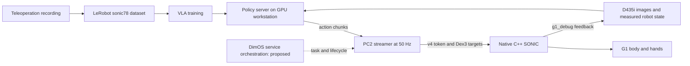

# LeRobot SONIC streaming reference for the DimOS service

Inspected 2026-10-08: `/home/jihun/work/lerobot`, commit
`bca7f48e49e3f3b0b0035e6e58980118939cb7ed`. Source hashes and dataset hashes are
recorded in the [offline compatibility evidence](/docs/artifacts/g1_lerobot_sonic_20261008/compatibility.json).

This checkout contains an existing G1 data → training → native SONIC execution
pipeline. It is the implementation reference for adding learned manipulation
to the DimOS service. The latest local bottle dataset already contains the
motion tokens used during teleoperation; it does not need our experimental
seven-joint feedback controller or a new joint-to-token conversion.

## Planner start and streaming v4

`--start planner --end planner` means this sequence in the current code:

1. Request native control with `start=true, stop=false, planner=true`.
2. After the operator positioning gate, read the planner's 64D `token_state`.
3. Publish that token for 50 ticks, then request `planner=false` (POSE mode).
4. With `--start planner`, keep the captured planner token as the rest reference.
   Stream it while the first policy chunk is computed, then blend into the first
   action over one second.
5. Stream v4 `pose` packets every 20 ms. The C++ SONIC controller consumes the
   external token and remains responsible for whole-body motor control.
6. Blend back, then request `planner=true`, leaving the native deployment alive.

Thus “planner start” describes the starting/ending stance and lifecycle.
External v4 token execution occurs in POSE mode. The command protocol is v1;
the token/hand packet protocol is v4. Protocol version and planner selection
are separate concepts.

Source: stream_backends.py (`/home/jihun/work/lerobot/examples/g1_dex3_training/stream_backends.py:143`).
The in-memory compatibility probe exercised this planner-start branch and
observed flags `[1,0,1] → [1,0,0] → [1,0,1]`, with increasing packet indices.
This verifies software behavior; it is not a new live controller-mode test.

## Pipeline and reusable files



| Resource in `lerobot/examples/g1_dex3_training/` | Role in our integration |
| --- | --- |
| prepare_wbt_sonic78.py (`/home/jihun/work/lerobot/examples/g1_dex3_training/prepare_wbt_sonic78.py`) | Converts recorded motion tokens and named joint fields into the 50 Hz training dataset. Runs conversion at module scope; read it rather than importing it into a service. |
| sonic_policy_server.py (`/home/jihun/work/lerobot/examples/g1_dex3_training/sonic_policy_server.py`) | GPU inference, checkpoint processors, image/state/task input, float32 action chunks over ZMQ REQ/REP. |
| sonic_policy_streamer.py (`/home/jihun/work/lerobot/examples/g1_dex3_training/sonic_policy_streamer.py`) | CPU-side camera/state observation, asynchronous chunk requests, 50 Hz send loop, episode checks and logs. |
| stream_backends.py (`/home/jihun/work/lerobot/examples/g1_dex3_training/stream_backends.py`) | Packet encoding and planner → POSE → planner lifecycle. |
| sonic_token_stream.py (`/home/jihun/work/lerobot/examples/g1_dex3_training/sonic_token_stream.py`) | Source-rate interpolation and optional blending between policy chunks. |
| sonic_targets.py (`/home/jihun/work/lerobot/examples/g1_dex3_training/sonic_targets.py`) | Named joint order and optional joint28/joint31 → sonic78 conversion. |
| g1_groot_real_run.sh (`/home/jihun/work/lerobot/examples/g1_dex3_training/g1_groot_real_run.sh`) | Existing workstation/PC2 deployment recipe; contains environment-specific addresses, paths and launch actions. Read as a reference, not as a DimOS library entry point. |
| g1_head_camera_server.py (`/home/jihun/work/lerobot/examples/g1_dex3_training/g1_head_camera_server.py`) | Camera-only publishing used by this pipeline. The generic G1 robot server also takes control-related actions and is not an equivalent camera-only substitute. |

The task layer can live in DimOS while the policy server remains in LeRobot's
environment and native SONIC remains the motor-command owner. A single streamer
owns the outgoing references; adding a DimOS module must not introduce a second
reference publisher alongside an active LeRobot streamer.

## Dataset and model contracts checked locally

The local source and converted bottle datasets both contain **43 episodes,
18,970 frames, 50 Hz**:

- Source: `/mnt/data/jihun/datasets/G1_WBT_GR00T/handover_bottle_260930_subset_261002`.
- Converted: `/mnt/data/jihun/datasets/G1_WBT_GR00T/handover_bottle_sonic78_50hz_261002`.

| Training feature | Exact contents |
| --- | --- |
| `observation.state`, 28D | Left arm 7, right arm 7, left Dex3 7, right Dex3 7; measured joints selected by name. |
| `action`, 78D | Recorded `action.motion_token` 64 + 14 named hand targets from `action.wbc`. |
| `observation.images.egocentric` | Recorded `ego_view`, renamed; metadata says 640×480 RGB. |

The raw 43D body/hand state interleaves hand and arm fields; the converter maps
names instead of slicing the first 28 values. The raw `action.wbc` body values
are controller setpoints, so they are not substituted for measured body pose.
The WBT dataset already contains the SONIC-reached state and requires no state
relabeling. Our audit checked every numeric state/action row exactly after
float32 conversion; it did not decode or compare the video frames.

The local checkpoint configs are present and agree on 28D state, 78D action and
`observation.images.egocentric`:

| Checkpoint directory under `/mnt/data/jihun/g1_models/` | Chunk length | Duration at 50 Hz |
| --- | --- | --- |
| `wbt_groot_he_full/pretrained_model` | 40 | 0.8 s |
| `wbt_pi05_he_full/pretrained_model_ema` | 50 | 1.0 s |

Only configuration files were checked this session; weights were not loaded and
inference was not run. The repository's WBT training/run report (`/home/jihun/work/lerobot/docs/research/2026-10-02-g1-wbt-handover-training.md:170`)
records real-robot bottle pick/handover results for GR00T and Pi0.5, including a
Pi0.5 watchdog abort. Those are prior recorded results, not observations from
this session or proof that these models can place an object in our target tray.

The run report uses `POLICY_FPS=50`, zero sampling noise, 0.3 s chunk blending,
0.4 s replanning, planner start/end and a 0.05 token-step setting. The launcher
has a different default token-step setting (0.1); an explicit model/run profile
must preserve the intended setting. Token-step limits are latent-value limits,
not joint-velocity limits. Policy/control rate is distinct from camera frame
rate; a 50 Hz dataset does not imply 50 distinct camera exposures per second.

Older Unitree/HE policies use 30 Hz chunks resampled onto the same 50 Hz send
loop. Joint28/joint31 policies need online encoding; direct sonic78 policies
bypass it. A model profile therefore needs both action format and source FPS.
The policy server's current `info` response supplies image keys, shapes and
observation-history length, but does not negotiate action format or FPS.

## DimOS compatibility evidence

The existing DimOS `encode_token_reference()` matches LeRobot's `pose_message()`
byte for byte for **all 18,970 recorded actions**, in both dataset/native hand
order and the explicit right-hand swap used by the documented MuJoCo bridge.
The DimOS encoder itself does not permute hands. Anatomical/physical hand
identity is not established by a serialization comparison.

Each packet is 1,604 bytes: `pose` topic + 1,280-byte padded JSON header + 64
float32 tokens + int64 wire frame index + two seven-float32 hand targets.
All four command combinations representable by LeRobot's helper match too.
The wire frame index increases across the stream; dataset frame indices are
episode-relative and must not reset a running wire sequence.

Forty recorded action rows round-trip exactly through `ChunkResampler(50)` at
their native timestamps. Eight existing resampler tests and two backend tests
passed in the DimOS Python environment using in-memory publishers. No sockets,
GPU inference, simulation, SSH or hardware actions were started.

Reproduce the audit:

```bash skip
PYTHONDONTWRITEBYTECODE=1 .venv/bin/python \
  docs/artifacts/g1_lerobot_sonic_20261008/demo_verify_lerobot_contract.py
```

## Work to carry into the DimOS adapter

The existing runtime is a useful behavioral reference, but a service needs
explicit ownership, lifecycle outcomes and cancellation. Preserve these facts
when wrapping or extracting its small streaming components:

- **Hand startup is an action.** `SonicBackend.start()` sends 14 zero hand
  targets while seeding the planner token. `finish()` also blends hand targets
  toward zero. This cannot be described as preserving an arbitrary held object;
  select a startup and recovery hand policy explicitly.
- **Completion needs observation.** The current `finish()` sends the planner
  command and prints a message; it does not wait for native planner confirmation.
  Retain the typed reference-guard feedback and native lease developed in DimOS's
  isolated tests. Their PC2 installation remains to be verified separately.
- **First-chunk wait needs a deadline.** The episode's chunk/state-age checks run
  after startup and first-chunk acquisition. The first-chunk wait can continue
  streaming rest without those checks. Cover startup, inference wait, execution
  and handback with phase-specific deadlines and feedback checks.
- **Chunk age and horizon differ.** The resampler holds the last action past a
  chunk's end. Validate the source rate, observation time, arrival time and
  unconsumed horizon, especially the 0.8 s GR00T chunks versus the current 1 s
  default no-new-chunk timeout. A recent arrival is not necessarily a recent
  observation. Do not copy one timeout to every model.
- **Cancel is a task operation.** Use an observed planner handback, with a
  task-appropriate hand policy. Native `stop` requests controller shutdown; it
  is not a synonym for canceling a manipulation task. The current CLI has no
  general `finally` that guarantees handback and log persistence on every
  exception or interruption.
- **Keep evidence during the run.** Persist task ID, phases, model profile,
  source/receive times, sequence numbers, chunk acceptance and measured results
  incrementally. The current CLI writes its accumulated `.npz` at normal finish.

The seven-joint controller's 0.05 rad / 0.20 rad/s hold qualifications belong to
that small precision exercise. They do not become VLA task-success criteria.
The accepted 20 mm tolerance remains relevant when evaluating an explicitly
specified hand-position goal; bottle grasp/placement additionally requires
observed object and hand outcomes.

## Revised next steps

1. **Completed here:** verify recorded-data conversion, source FPS, hand order
   and LeRobot/DimOS packet compatibility without operating the robot.
2. **Offline foundation completed:** the [DimOS task session](/docs/platforms/humanoid/g1/sonic-task-session.md)
   implements explicit model profiles, start/status/cancel, typed feedback,
   observed handback and incremental results, with one injected publisher owner.
   The focused SONIC suite passes 182 tests; six scripted cases exercise normal
   completion, cancellation and faults. Transport ownership and native execution
   remain to be connected and validated.
3. **Native boundary validation completed:** [episode 42 and four fault cases](/docs/platforms/humanoid/g1/sonic-native-session-validation.md)
   ran through the session in isolated SONIC/MuJoCo. This episode belongs to the
   recorded training dataset, so the result is execution/recovery evidence,
   not held-out policy evaluation. Startup contact and measured speed peaks
   remain documented limits before physical commissioning.
4. Connect the existing LeRobot policy server and matching camera/state inputs.
   Treat recorded-image replay as execution evidence; live camera response and
   object interaction need their own validation.
5. Commission the validated session on `pc2_222`, then collect/fine-tune and
   verify the chosen **object-to-tray** service. Existing bottle-handover results
   are a useful baseline, while tray placement still needs task-specific proof.

Keep the earlier seven-joint experiment for explicit joint/Cartesian command
work. Its two hold aborts and DDS teardown issue remain recorded; they do not
require rebuilding an already-working recorded-token dataset/VLA pipeline.
