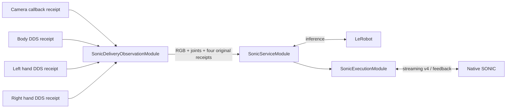

# Supervised SONIC observations using delivery freshness

The selected prototype uses **delivery freshness**: DimOS checks whether the
camera, body and each hand keep delivering data. Sensor acquisition age and
acquisition skew remain unknown. This provides a practical path toward a
supervised service without inventing timing guarantees for Unitree's publishers.
DimOS supervises the task, LeRobot supplies predictions and native SONIC owns
motor control.

The adapter and service integration are implemented locally. The first
[live hardware pairing check](/docs/platforms/humanoid/g1/sonic-delivery-live-validation.md) passed on
2026-10-14 using the existing LeRobot camera server and independent DDS readers.
Service commissioning remains pending. The bounded diagnostics are reference
receiver implementations; there is no persistent hardware receiver blueprint
yet. This work has not established bottle-to-tray success.

## What changes



Receivers, adapter and service share PC2's Linux monotonic clock. The inference
server may run on another computer. These receipt times cannot be compared to
another host's monotonic clock without a separate mapping.

| Port | Record | Receipt boundary in the diagnostic |
| --- | --- | --- |
| `camera_delivery` | `SonicCameraDelivery` | Python image callback, before copying/forwarding |
| `body_delivery` | `SonicJointDelivery(group="body")` | DDS `take()` completion, before conversion/forwarding |
| `left_hand_delivery` | `SonicJointDelivery(group="left_hand")` | Independent left-hand DDS reader |
| `right_hand_delivery` | `SonicJointDelivery(group="right_hand")` | Independent right-hand DDS reader |

Each record retains `source_id`, `source_marker` and `received_at`. The diagnostic
uses the camera's original timestamp and DDS publication timestamps as opaque
markers. They are not acquisition timestamps or proof of new measurements.
DDS publication handles identify the source within that receiver session;
they are not authenticated publisher identities.

The adapter keeps the latest record for each component and requires all four
markers to advance before emitting another observation. Body slots 15–28 supply
the 14 arm joints. Explicit seven-name hand maps select policy joint order.
The output owns its image/state data and preserves the **oldest** original
receipt as `observed_at`. Forwarding and inference cannot refresh it. Separate
input ports prevent DimOS's latest-message mailbox from coalescing different
joint groups.

Duplicates are rejected. A source change, marker rollback or invalid local
clock latches a fault and stops publication. Replace the receivers, adapter
and service together after a restart/fault; restarting only the adapter cannot
silently reuse the service's old session. An already delivered snapshot may
remain usable until its configured freshness deadline expires.

## Timing configuration

Three budgets have different meanings:

| Setting | Meaning |
| --- | --- |
| Adapter `max_delivery_age_seconds` and service `observation_max_age_seconds` | Maximum age since original local receipt; default and maximum 0.2 s |
| Adapter `max_delivery_span_seconds` | Allowed difference between the four receipts; explicit and no greater than the adapter age budget |
| Execution profile `max_observation_age` | Prediction age measured from that same oldest receipt, including inference time; subject to the existing action horizon checks |

For example, a 300 ms inference can coexist with a 200 ms input-liveness
deadline: new observations continue arriving while inference processes its
captured snapshot. The execution profile must separately permit the result's
age. Neither budget establishes a guaranteed physical stopping latency;
scheduling, RPCs and native recovery contribute to that latency. Hardware
budget selection and end-to-end recovery measurements remain required.

Delivery observations carry `time_basis="delivery"`. Configure both
`SonicServiceModule.observation_time_basis` and
`SonicModelProfile.observation_time_basis` as `"delivery"`, and give the
execution profile a distinct name that the service also requires. Existing
callers default to `"acquisition"`. A basis mismatch fails before admission.
The existing [service composition example](/docs/platforms/humanoid/g1/sonic-service-coordinator.md#compose-the-stack)
is a simulation configuration; its hand mapping and timing values are not a
commissioned hardware profile.

During seeding, inference waiting and streaming, expired delivery observations
request the existing execution recovery. Recovery continues to use native
feedback and handback checks, even when camera/state delivery has stopped.
Source faults also prevent a task from starting after an asynchronous preflight.

Adapter status exposes individual `delivery_ages_s`, `delivery_span_s`, source
provenance and rejection counts. Service status exposes `delivery_age_s`,
`input_liveness_max_age_s` and `prediction_max_age_s` (the latter becomes known
after execution-profile preflight). Both report acquisition age/skew as `null`.
Service journals retain the basis, both age budgets and the four receipts for
each inference request.

Delivery time excludes earlier camera, publisher, network and DDS queue delay.
A publisher that restamps old sensor values can evade these checks. This path
does not establish acquisition synchronization, physical finger identity,
controller readiness or task success. The strict
[acquisition adapter](/docs/platforms/humanoid/g1/sonic-observation-adapter.md) remains available when
documented timing bounds can be supplied.

## Read-only hardware probe

`demo_g1_sonic_delivery.py` (`/scripts/demo_g1_sonic_delivery.py`) runs
the native DimOS RealSense camera, three DDS readers and the delivery adapter
for 2–30 seconds. It creates no service, policy client, robot command writer or
controller client. It saves one image and a JSON report, then stops its camera,
subscriptions, adapter and Zenoh sessions. DDS participants close at process
exit. Native-camera dependencies must already be installed; the script does
not build or install them.

The 2026-10-13 [PC2 ownership check](/docs/artifacts/g1_delivery_observation_20261013/pc2-preflight.json)
found PID 15857, `g1_head_camera_server.py`, owning `/dev/video4`. Therefore the
new native-camera probe was **not run**. That session was left running. Recheck
ownership immediately before any probe; either arrange an idle camera or
implement a subscriber for the active server's actual wire/color contract.

On 2026-10-14 the camera was occupied again by the LeRobot server. A separate
[subscriber-only diagnostic](/docs/platforms/humanoid/g1/sonic-delivery-live-validation.md) used that
server's verified protocol and passed the first real four-input pairing check.

Once this checkout and its dependencies are available on PC2 and the camera
is idle, the following is a diagnostic example. `enP8p1s0` is the interface
previously observed on pc2_222; verify it for the current boot. The hand lists
express the native software convention, still requiring physical validation.
The 100 ms receipt-span value is a provisional probe setting, not a measured
sensor skew bound. Use a new output directory for each run.

```bash skip
cd /home/unitree/dimos
export DIMOS_TRANSPORT=zenoh
export DIMOS_ZENOH_SCOUTING=false
export DIMOS_ZENOH_INTERFACE=lo
export DIMOS_ZENOH_CONNECT=
export DIMOS_ROBOT_IP=
export DIMOS_ROBOT_IPS=

.venv/bin/python scripts/demo_g1_sonic_delivery.py \
  --interface enP8p1s0 --seconds 8 --max-delivery-span 0.10 \
  --left-hand-slot-names left_hand_thumb_0_joint,left_hand_thumb_1_joint,left_hand_thumb_2_joint,left_hand_middle_0_joint,left_hand_middle_1_joint,left_hand_index_0_joint,left_hand_index_1_joint \
  --right-hand-slot-names right_hand_thumb_0_joint,right_hand_thumb_1_joint,right_hand_thumb_2_joint,right_hand_index_0_joint,right_hand_index_1_joint,right_hand_middle_0_joint,right_hand_middle_1_joint \
  --output /tmp/g1-delivery-probe-01
```

Exit 0 requires at least one paired observation, fresh final adapter status and
a clean camera exit. Inspect counts, individual ages, span and rejections in
`result.json`; success describes this bounded delivery check only.

## Validation and remaining work

On 2026-10-13, **366 focused SONIC tests passed**, including 39 new cases for
delivery metadata, independent component expiry, duplicate/restarted sources,
typed transport behavior, profile agreement, inference/seed dropout recovery
and preflight faults. Independent source review found no remaining material
issues after fixes. The [verification record](/docs/artifacts/g1_delivery_observation_20261013/verification.json)
records tests, type/lint checks, registry generation and the ownership check.
The complete repository suite was not run.

The [first real four-input pairing check](/docs/platforms/humanoid/g1/sonic-delivery-live-validation.md)
passed with bottle framing on 2026-10-14. Next, confirm physical finger mapping,
complete tray framing, and package the selected receivers into the deployment.
Verify the native reference-guard route, then measure
dropout recovery with that runtime, commission a short supervised service with
a compatible policy and finally evaluate bottle-to-tray outcomes separately
from streaming completion. None of those steps is implied by passing these
local tests.
