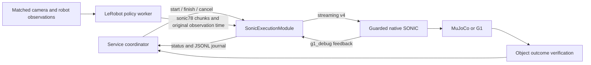

# SONIC execution as a DimOS module

The refocused work packages the existing SONIC session as a reusable service
component. DimOS owns requests, execution status, cancellation and evidence;
an external action source supplies motion, and SONIC retains motor control.
Grasp geometry and policy training remain separate work.



## What is implemented

[`SonicExecutionModule`](/dimos/robot/unitree/g1/sonic_execution_module.py)
wraps [`SonicTaskSession`](sonic-task-session.md) in the normal DimOS module
lifecycle. One module event loop owns the ZMQ publisher, telemetry subscriber,
session state and all mutating RPCs. Inference runs outside that loop.

Starting the module opens sockets and listens. It sends no controller command
until `start_task()` is called. Admission requires fresh guarded planner
feedback, its coherent token state, and both command/pose subscriptions.
Only one task can be active. Each admitted task receives a new ID and journal.

Feedback is drained without conflation so an observed ownership fault cannot
be replaced by a newer healthy sample before the session checks it. Queue
overload, socket errors and subscription loss fault the module. Session-level
failures stop policy references and request planner handback. Shutdown waits
for confirmation or the configured handback deadline; concurrent stop calls
cannot close the event loop early.

The output remains capped at one reference per 20 ms by the session core.
The Python event loop and journal filesystem are not hard real-time. Native
receiver expiry is still required if the process stalls or disappears.

## Configuration and composition

All endpoints and the model profile are explicit. There is no preconfigured
robot IP or automatic controller launch. This example **defines** a blueprint:

```python skip
import os
from pathlib import Path

from dimos.robot.unitree.g1.sonic_execution_module import SonicExecutionModule
from dimos.robot.unitree.g1.sonic_session import SonicModelProfile

sonic_execution = SonicExecutionModule.blueprint(
    reference_bind=os.environ["SONIC_REFERENCE_BIND"],
    feedback_endpoint=os.environ["SONIC_FEEDBACK_ENDPOINT"],
    journal_dir=Path(os.environ["SONIC_JOURNAL_DIR"]),
    profile=SonicModelProfile(
        name="validated-simulation-profile",
        source_fps=50,
        right_hand_order="mujoco_swap",
        handback_policy="native_planner",
        max_observation_age=0.85,
    ),
)
```

`reference_bind` is the TCP endpoint that this module binds; SONIC subscribes
to it. `feedback_endpoint` is the TCP publisher endpoint provided by SONIC.
Both accept `tcp://...` endpoints. Model FPS, hand mapping and observation-age
budget must match the selected deployment. The example's simulated right-hand
mapping is not the hardware profile. Module handback timeout is limited to
five seconds; its default is two seconds.

Compose this blueprint with the service's other modules using `autoconnect()`.
After building the stack, obtain the proxy with
`coordinator.get_instance(SonicExecutionModule)`, or inject a service-specific
`Spec` declaring the RPCs it needs. The generated module registry also lists
`sonic-execution-module`; it still requires explicit configuration.

Do not combine this execution route with another arm or body command writer.
Binding excludes a second publisher on the same TCP endpoint only. The v4
protocol has no network ownership nonce and cannot exclude another host or
another endpoint. The existing guarded SONIC receiver build is a prerequisite;
an unmodified upstream controller is not an equivalent deployment.

## Service-facing RPCs

| RPC | Contract |
| --- | --- |
| `get_status()` | Module readiness, feedback freshness, current/latest task, journal path and transport error. |
| `get_feedback()` | Fresh immutable decoded telemetry, or `None`. Receipt time uses this host's monotonic clock. |
| `start_task()` | Returns a new task ID and initial status; rejects overlap or missing prerequisites. |
| `submit_chunk(task_id, sequence, observed_at, actions)` | Validates finite sonic78 `[N,78]` actions and original observation time; rejects old IDs, sequence regressions and expired chunks. |
| `finish_task(task_id)` | Action source has ended; request native planner control. |
| `cancel_task(task_id)` | Stop policy streaming and request native planner control. |
| `fail_task(task_id, reason)` | Record an action-source failure and request native planner control. |

Mutating RPCs serialize on the module event loop. Synchronous callers and
worker-process proxies call them normally; async code on the module's own
loop awaits them. Finish/cancel/fail return the current status, which can
still be `handback`; poll until `phase == "done"` for the terminal result.
Typed output streams expose `feedback` and `execution_status` to other modules.
Capture terminal status before calling `stop()` through a worker proxy:
shutdown closes the module's RPC endpoint. The task journal remains available
after the worker has stopped.

`phase="done"` with `outcome="finished"` means streaming ended and the
controller handed back. During `handback`, the outcome is still provisional.
`handback_confirmed=True` describes the controller path. Neither establishes
a successful grasp, a retained object or physical settling. `task_success`
therefore remains `None`; the service must verify its object-level outcome.

## Connecting the existing LeRobot client

The [policy client](/docs/platforms/humanoid/g1/sonic-policy-integration.md) already returns a
`SonicPolicyChunk`. Run its blocking inference in the service's worker, then
forward the result through the module proxy:

```python skip
execution.submit_chunk(
    task_id=chunk.task_id,
    sequence=chunk.sequence,
    observed_at=chunk.observed_at,
    actions=chunk.actions,
)
```

Use the ID returned by `start_task()` in every inference request, and wait for
`waiting_for_chunk` before submitting the first result. Preserve the timestamp
captured with the model observation; do not replace it with inference-arrival
time. Capture and module receipt must use the same host's monotonic clock.
Inference on another machine needs its request's original local timestamp
carried back unchanged. If inference fails, report `fail_task()` and continue
observing status through handback.

The module does not select a checkpoint, generate observations, or run the
policy itself. Those responsibilities stay with the existing observation and
LeRobot components. Transport faults latch until the module is replaced;
late results cannot restart a terminal session. Journals persist each task's
evidence, while `get_status()` retains only the current/latest task. Process
restart does not resume a task.

## Verification

The initial packaging check on 2026-10-12 passed **232 focused SONIC tests**, including 10 new
module tests and 55 session-core tests. All five registry-generation checks
passed in comparison mode after regeneration. Focused Ruff formatting/lint
and production mypy checks passed. The complete repository suite was not run.
The test environment still emits the previously observed subprocess
`ResourceWarning` during startup.

Test log (`../../../artifacts/g1_sonic_execution_20261012/pytest.log`),
registry check (`../../../artifacts/g1_sonic_execution_20261012/registry.log`),
and [verification record](/docs/artifacts/g1_sonic_execution_20261012/verification.json)
record this module-packaging step. No native controller, physics simulation,
GPU inference server or hardware connection was started for these checks.

The adjacent tests use real loopback TCP ZMQ sockets and a scripted protocol
peer, including a DimOS worker-process RPC case. The peer is not a physics
simulation or native SONIC. Tests cover passive startup, exclusive binding,
streaming/finish, cancellation, stale observations, missing feedback,
subscription loss, action-source failure, task isolation and bounded shutdown.

```bash skip
.venv/bin/python -m pytest -q \
  dimos/robot/unitree/g1/test_sonic_execution_module.py \
  dimos/robot/unitree/g1/test_sonic_session.py
```

The subsequent [native validation](/docs/platforms/humanoid/g1/sonic-execution-native-validation.md)
replaced the experimental transport/session loop with this module's actual
blueprint and worker RPC. Live Pi0.5 inference, finish, cancellation and camera
expiry passed with native SONIC and MuJoCo. That run exposed and fixed a
receive-loop arrival race; the expanded suite passes **238 tests**, including
16 module tests. The validation guide records timing, recovery, replay and
the failed diagnostic attempts.

The [service coordinator](/docs/platforms/humanoid/g1/sonic-service-coordinator.md) now connects this
execution interface to named policies, paired observations and request,
progress, cancel and outcome-report RPCs. It has passed local protocol and
worker-process checks and [native service validation](/docs/platforms/humanoid/g1/sonic-service-native-validation.md)
with Pi0.5, SONIC and MuJoCo.
Hardware commissioning remains separate; these checks do not establish a
completed bottle-to-tray service.
