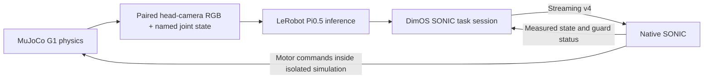

# Live simulated observations through Pi0.5 and SONIC

Validated on 2026-10-09. The policy now receives **live simulated RGB and
measured joint positions**, and its predictions drive the same simulated G1
through DimOS and native SONIC. This closes the observation/action feedback
path. It does not yet demonstrate grasping, placement or real-camera behavior.

## What was added

`sonic_observation.py` (`/dimos/robot/unitree/g1/sonic_observation.py`)
defines the WBT policy's named 28-joint state order and an owned RGB/state
snapshot. It rejects malformed, duplicate, future and stale observations.
Snapshot arrays are copied and read-only; receipt/render time does not replace
the source timestamp.

The camera worker (`../../../artifacts/g1_sonic_live_20261009/demo_live_camera.py`)
reads an atomic physics snapshot from the running simulator, copies its
`qpos` into a separate MuJoCo rendering model, and derives RGB and joint state
from that same snapshot. Rendering runs in a separate process, so it does not
block physics or the 50 Hz reference loop. The camera publishes at 10 Hz;
policy requests run every 400 ms; action chunks retain their 50 Hz source rate.

Only the main thread calls the task session. One worker performs inference;
late results cannot restart a cancelled or expired session. The client,
session, guarded native binary and inference-only IPC bridge are unchanged
from the [recorded-input milestone](/docs/platforms/humanoid/g1/sonic-policy-integration.md).

## Camera and state compatibility

- All 28 named joints match the training dataset. Name-based lookup handles
  the MuJoCo tree's interleaved arms/hands and the different right-hand
  index/middle finger ordering. No simulation hand permutation is applied
  twice.
- RGB is `uint8 [480,640,3]`, matching the checkpoint. The nominal MJCF
  `head_camera` is attached to `torso_link`, at `[0.06,0,0.45]` m, with a
  45° vertical field of view.
- At 640×480, the nominal rendering intrinsics are approximately
  `fx=fy=579.41, cx=320, cy=240`. Previously measured PC2 D435i intrinsics
  were approximately `fx=604.18, fy=603.91, cx=316.75, cy=255.63`.
  The camera mounting transform has not been calibrated to hardware.
- The policy's original instruction remains “pick drink bottle from the
  table and handover”. This trial uses the empty checker-floor scene. Its
  images differ substantially from training images and contain no bottle,
  table or tray.

This configuration tests feedback plumbing, timing and controller recovery.
Successful streaming is not evidence of visual task understanding or
transfer to the D435i.

The first sandbox benchmark rendered in roughly 244 ms, too slow for the
200 ms input-age bound. With host GPU access, the same camera used an RTX 3060
and rendered in roughly 2 ms. The final run's median was **1.76 ms**. Source
timestamps remained unchanged in both benchmarks.

## Authoritative results

Evidence: [run02 result](/docs/artifacts/g1_sonic_live_20261009/run02/result.json)
and [`run02/audit.json`](/docs/artifacts/g1_sonic_live_20261009/run02/audit.json).

| Case | Result | Accepted predictions | Planner confirmation after request |
|---|---|---:|---:|
| Live RGB/state, six seconds | Finished | 15 | 141 ms |
| Cancel at 1.5 seconds | Cancelled; outstanding prediction discarded | 3 | 141 ms |
| Freeze camera at 1.5 seconds | Failed with `observation stale`; planner recovered | 5 | 242 ms |

The camera-freeze case is an **expected failure of the task** and a passing
recovery test. One final previously unused frame was still fresh enough to
request inference after freezing. It retained its capture time; the session
requested handback about 847 ms after the freeze, when its last observation
exceeded the 850 ms age limit. The original 200 ms camera-admission bound and
850 ms session age limit were not relaxed.

Normal live execution measurements:

| Measurement | Result |
|---|---|
| Distinct policy inputs | 15 RGB images and 15 joint states |
| Inference round trip | 290–318 ms |
| Observation age when prediction accepted | 328–434 ms |
| Reference packet spacing | Median 20.165 ms; maximum 23.595 ms |
| Reference packets, including startup holds | 351 |
| Minimum pelvis height / maximum tilt | 0.783 m / 8.50° |
| Falls, resets, support band | None; support disabled |
| Peak arm speed including return to planner | 3.659 rad/s |

The 3.659 rad/s peak was right wrist roll, about 664 ms after the normal
handback request. The largest peak across all cases was **5.867 rad/s** at
right wrist roll during the cancellation case, about **848 ms before** the
cancel request. It is not attributed to cancellation or dismissed as the
previously discussed contact-slip event. These measurements still require
hardware-specific motion limits and clearance review.

All three owned children, simulator, controller and camera worker, exited with
code 0. Cleanup explicitly confirmed planner mode and produced no cleanup
warning. The existing LeRobot inference server was left running.

## Evidence checks and replay

The independent audit checked all **280 camera snapshots** against their
original physics `qpos`, named-joint state, timestamps and exact RGB hashes.
It matched the saved policy inputs and returned prediction hashes to the
session journal, checked ordered wire indices and verified no pose references
after handback. Fault success requires actual injection and frozen-source
evidence; overall success requires clean child-process shutdown.

- Replay: robot motion beside the RGB frames sent to the policy (`../../../artifacts/g1_sonic_live_20261009/run02/replay/live_policy_replay.mp4`)
- Measured arm/hand speed plot (`../../../artifacts/g1_sonic_live_20261009/run02/replay/joint_speeds.png`)
- [Camera geometry and joint indices](/docs/artifacts/g1_sonic_live_20261009/run02/camera-info.json)
- Native live-observation harness (`../../../artifacts/g1_sonic_live_20261009/demo_native_live.py`)
- Private-namespace launcher (`../../../artifacts/g1_sonic_live_20261009/demo_run_trial.sh`)

The replay is a visualization of saved physics. Its right pane shows the
latest RGB sample submitted to the model, held until the next request; it is
not a continuous camera video. Playing it does not run robot control.

Verification: **93 focused tests passed** (18 observation, 21 policy client,
54 session), Ruff passed, and focused mypy passed. The full repository suite
was not run. A separate review found and fixed false-pass conditions around
fault injection and cleanup; the authoritative run was repeated afterward.

## Next step toward object-to-tray service

Build a reproducible table/object/tray simulation scene and define measurable
grasp and placement success. Validate camera visibility, reachability,
table/body clearance, Dex3 limits and recovery before evaluating a task
policy. The current handover checkpoint is useful for integration testing;
its suitability for tray placement still needs evaluation or task training.

Real-robot commissioning remains a later stage: calibrated D435i mounting,
the exact guarded PC2 controller, hand limits, unloaded manipulation tests
and recovery while holding an object. The integration is still exercised by
bounded harness scripts; packaging it as a DimOS service module/blueprint and
agent skill remains outstanding.
