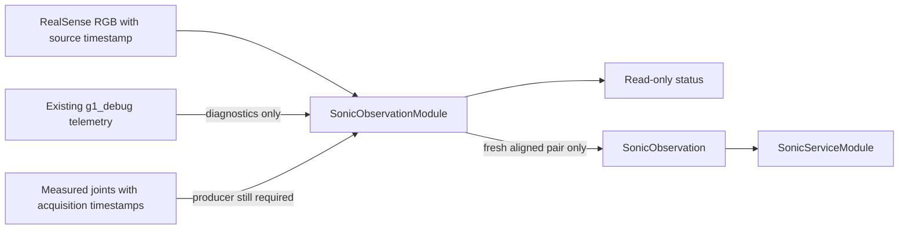

# D435i and measured-joint observation adapter

`SonicObservationModule` connects camera/state acquisition to the
[SONIC service coordinator](/docs/platforms/humanoid/g1/sonic-service-coordinator.md). It provides
read-only diagnostics now and publishes service observations only when a
producer supplies acquisition-time estimates with established absolute error
bounds for the body and both Dex3 hands.
It has no controller commands, inference calls or motion lifecycle operations.

Source: module (`/dimos/robot/unitree/g1/sonic_observation_module.py`)
and pairing logic (`/dimos/robot/unitree/g1/sonic_observation_pairing.py`).

For the supervised prototype selected after the timing audit, use the separate
[delivery-freshness adapter](/docs/platforms/humanoid/g1/sonic-delivery-observations.md). It explicitly
reports unknown acquisition age/skew; receipt times do not satisfy this page's
acquisition contract.

## Current hardware boundary

On 2026-10-13, pc2_222 was reachable and its D435i camera-only check passed
again: 640×480 RGB and aligned depth, approximately 15 Hz, clean native exit.
No SONIC deployment, camera publisher or policy streamer was running during
the initial process inspection. The subsequent adapter probe was subscriber-only.

The 10-second read-only adapter probe completed successfully:

| Check | Observed result |
| --- | --- |
| RGB capture | 135 frames, 15.14 Hz |
| Adapter image acceptance | 134 accepted; one rejected as stale/future/invalid |
| Reported camera timestamp to local receipt | 86.37 ms median; 236.26 ms maximum |
| SONIC telemetry / timestamped measured state | Neither available during this probe |
| Service observations | Zero; adapter stayed `waiting` for acquisition timestamps |
| Cleanup | Native camera exit 0; no matching camera/controller/streamer processes or temporary overlays remained |

The reported timestamp-to-receipt interval includes the camera's timestamp
semantics and has not been calibrated as acquisition latency. The
captured image (`../../../artifacts/g1_sonic_observation_20261013/pc2-camera.png`)
shows the floor and nearby furniture; bottle/tray framing still needs setup.
The [probe result](/docs/artifacts/g1_sonic_observation_20261013/pc2-result.json)
and [cleanup check](/docs/artifacts/g1_sonic_observation_20261013/pc2-cleanup.json)
record the measurements. Code ran from a temporary import overlay; this probe
did not install changes in PC2's DimOS checkout.

Inspection of the native SONIC source identified an acquisition-timing gap:

The follow-up [hardware timing audit](/docs/platforms/humanoid/g1/sonic-hardware-timing.md) confirms the
gap in the installed body/Dex3 message definitions and measures DDS reader
behavior. It also records a newly active external camera publisher and changing
SONIC processes; recheck ownership before repeating the native-camera probe.

- `g1_debug` contains measured body and hand values, an increasing logger
  index, and `ros_timestamp`.
- `GetRosTimestamp()` returns zero when no ROS2 output interface exists.
  With ROS2, it reads the output interface's current clock; that still does
  not establish when each body/hand measurement was acquired.
- The native state logger records additional clock values internally, but
  the inspected ZMQ output does not expose per-component acquisition times.

Consequently, neither packet receipt nor `ros_timestamp` unlocks service
observations. Installing ROS2 or synchronizing wall clocks alone does not fix
this measurement-timing gap. The adapter deliberately retains separate inputs
for diagnostic telemetry and timestamped measured state.



## Input and output contract

All producers, the adapter and service must run on the **same Linux host**
and monotonic clock. For pc2_222, keep this path on its onboard computer;
the policy server can remain on the GPU workstation. Cross-host acquisition
clock conversion is outside this adapter.

| Port | Type | Use |
| --- | --- | --- |
| `color_image` | `Image` | RGB `uint8[480,640,3]`, configured optical frame ID, original same-host UNIX source timestamp |
| `feedback` | `SonicFeedback` | Receipt freshness, explicitly mapped joint values and diagnostic time offset; cannot emit observations |
| `measured_state` | `SonicMeasuredState` | Named measured positions and body/left-hand/right-hand acquisition estimates in local monotonic seconds, with absolute error bounds |
| `observation` | `SonicObservation` | One owned RGB/state snapshot in policy joint order; feeds the existing service input |

`SonicMeasuredState` requires an increasing sequence and all three acquisition
estimates to advance. `acquisition_uncertainty_seconds` is a tuple of three
finite, nonnegative absolute error bounds in **body, left hand, right hand**
order. Its zero default preserves exact-time/synthetic callers; zero must
never stand for an unknown hardware bound. Each interval is the estimate
minus/plus its bound. A standard deviation, observed jitter or the largest
delay in a short trace does not establish an absolute bound.

Every interval endpoint must be fresh and no later than the current host
monotonic time. Malformed bounds and stale, future or repeated component
estimates are rejected before the sample consumes a sequence number.
Producers must not fill a missing hand with zeroes or restamp cached values:
preserve each measurement's original estimate and bound. Increasing estimates
alone do not prove actual acquisition order when intervals overlap.
Joint values are selected by
[`POLICY_JOINT_NAMES`](/dimos/robot/unitree/g1/sonic_observation.py)
through `policy_joint_state()`, preserving the dataset's different left/right
finger ordering.

The adapter retains one pending image and at most 32 measured-state samples.
It matches a delayed image against this history, consumes each image/state at
most once, and expires every buffered state independently using its oldest
lower bound at the configured age limit, at most 200 ms. Independent expiry
matters because a later estimate can have an earlier lower bound when its
uncertainty grows. Acquisition skew is the span from the earliest to the
latest possible acquisition across the image, body and both hands. This is a
separate explicit budget; the diagnostic profile's 30 ms setting has not been
commissioned on hardware.

For example, a synthetic hand estimate of `10.000 ± 0.016` seconds describes
`[9.984, 10.016]`. Even if the image and other state estimates are exactly
`10.000`, that 32 ms span fails a 30 ms skew budget. Accepted observations
retain the oldest lower bound; if that would repeat or regress the previous
output time, the adapter waits for a newer aligned pair instead of moving
the timestamp forward.

Camera UNIX timestamps use a fixed, bracketed conversion to the host's
monotonic clock. The image's time interval includes initial clock-sampling
uncertainty, allowed offset drift and the explicitly configured camera
timestamp-error bound. Both interval ends participate in freshness and skew
checks together with all body/hand interval endpoints. `observed_at` is the
oldest possible acquisition time, so transport or pairing delays never
refresh the observation.

Clock discontinuities or excessive sampling uncertainty latch a fault and
invalidate the buffers. Rebuild the adapter and service as a new session;
output sequences restart at zero. Replacing only the adapter while retaining
a service's prior sequence history can cause new observations to be rejected.
The camera error bound must be established for the actual source; setting a
number in configuration is not a synchronization measurement.

## Composition

The existing native `RealSenseCamera` and subscriber-only `SonicFeedbackModule`
can supply the first two inputs. The `measured_state` producer remains the
next hardware integration task. Do not relabel diagnostic telemetry to fill it.

```python skip
from dimos.robot.unitree.g1.sonic_observation_module import SonicObservationModule


def observation_adapter(left_slots, right_slots, max_skew, camera_time_error):
    return SonicObservationModule.blueprint(
        camera_frame_id="d435_color_optical_frame",
        left_hand_slot_names=left_slots,
        right_hand_slot_names=right_slots,
        max_skew_seconds=max_skew,
        camera_timestamp_error_seconds=camera_time_error,
    )
```

Hand slot lists must each name the corresponding seven policy joints exactly
once, in telemetry slot order. The LeRobot real-robot convention is left
thumb/middle/index and right thumb/index/middle. Physical finger identity and
the selected runtime's mapping still need confirmation; the MuJoCo right-hand
swap is a distinct configuration.

Call `get_observation_status()` to inspect camera age, measured-state age
(from the oldest possible component acquisition),
feedback receipt age, accepted/rejected counts, clock uncertainty and the
readiness reason. `camera_source_to_feedback_receipt_s` is explicitly a
source-to-receipt offset, not a measured acquisition skew. `state="fresh"`
describes the latest paired observation, not controller or task readiness.

## Bounded hardware diagnostic

`scripts/demo_g1_sonic_observation.py` (`/scripts/demo_g1_sonic_observation.py`)
starts only the native camera, feedback subscriber and observation adapter.
It uses unique loopback topics, listens on an isolated unwritten
`measured_state` topic, saves one RGB snapshot and reports freshness. Collection
is bounded to 2–30 seconds; cleanup attempts every stop and unsubscribe even
if another cleanup fails. It does not start SONIC, a service or a policy.

Run on PC2 with the required modules installed, an idle camera, the established
native RealSense setup and an explicit telemetry endpoint:

```bash skip
DIMOS_TRANSPORT=zenoh DIMOS_ZENOH_SCOUTING=false DIMOS_ZENOH_INTERFACE=lo \
  DIMOS_ROBOT_IP= DIMOS_ROBOT_IPS= DIMOS_ZENOH_CONNECT= \
  .venv/bin/python scripts/demo_g1_sonic_observation.py \
  --feedback-endpoint tcp://127.0.0.1:5557 \
  --seconds 10 --output /tmp/g1-observation-check
```

Choose a new output directory. The provisional hand and timing settings in
this diagnostic do not authorize service output. Exit zero means camera
diagnostics completed and the service-output gate remained closed; it does
not mean camera/state alignment passed.

## Software verification

The initial adapter's focused SONIC suite passed **293 tests**, including **31 new adapter/pairing
cases**. They cover named joint ordering, owned snapshots, delayed-frame
matching, individual hand expiry, replay/frozen timestamps, bounded buffers,
clock uncertainty/drift, repeated startup, module replacement and actual typed
stream delivery. Synthetic acquisition times exercise the service-output path;
they do not validate hardware timestamps.

The generated module registry was updated. All five registry comparison
checks passed; the initial generation command intentionally failed because
the regenerated file was uncommitted. Focused Ruff and production/probe mypy
checks passed. The full repository suite was not run. The existing pytest
startup subprocess `ResourceWarning` remains visible in the
test log (`../../../artifacts/g1_sonic_observation_20261013/pytest.log`).

An independent source review identified clock-uncertainty accounting and
probe cleanup improvements; both were fixed and checked. The
[verification record](/docs/artifacts/g1_sonic_observation_20261013/verification.json)
records source hashes, hardware evidence and limits.

The follow-up interval extension adds 22 tests: **327 SONIC tests pass**,
including **53 adapter/pairing tests**. Ruff check/format and focused mypy
passed, and independent source review found no material issues. The new
cases cover component bounds,
full-interval freshness/skew, independent buffer expiry, rejected-sequence
reuse and uncertainty preservation through typed module streams. See the
[interval verification record](/docs/artifacts/g1_sonic_intervals_20261013/verification.json)
for logs and source hashes. This extension
uses synthetic inputs; it does not establish hardware bounds.

The local LeRobot reference
`examples/g1_dex3_training/sonic_policy_streamer.py` was also inspected:
`StateSubscriber` measures time since telemetry receipt, while `LiveImages`
retains the latest decoded image without carrying timestamp metadata into
pairing. That working streaming path does not supply this adapter's
acquisition-time contract. No LeRobot code was changed.

## Remaining integration work

1. Establish acquisition timing at the actual body/hand source, or validate
   acquisition intervals for the implemented bounded-time contract. The
   [timing audit](/docs/platforms/humanoid/g1/sonic-hardware-timing.md) explains why copying native buffer
   receipt times cannot supply acquisition estimates and their bounds. Preserve
   source freshness through transport and validate the producer in isolation.
2. Confirm hand slot identities, camera timestamp error, framing and image/state
   alignment on pc2_222. Measure the accepted skew budget and validate camera
   mounting/calibration where the task needs geometric coordinates.
3. Wire the validated producer into `measured_state`, then repeat camera/state
   dropout tests before supervised hardware service commissioning.
4. Add object-outcome verification and validate the requested bottle-to-tray
   task with a matching policy. The current handover checkpoint and empty-scene
   simulation do not establish tray-placement success.
