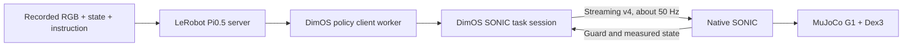

# LeRobot policy inference through DimOS and SONIC

Validated on 2026-10-09 in isolated MuJoCo simulation. Real Pi0.5 predictions
now pass through the DimOS task session into native SONIC streaming v4. The
model receives recorded RGB and robot-state observations from episode 42;
live visual feedback and object-to-tray manipulation remain later milestones.

## What changed

- `sonic_policy_client.py` (`/dimos/robot/unitree/g1/sonic_policy_client.py`)
  implements LeRobot's `sonic_policy_server.py` MessagePack REQ/REP contract.
  It checks image/state shapes, response dimensions, finite actions and timing
  fields. Each request owns its socket, including timeout cleanup.
- A result carries its original local `task_id`, `sequence`, and `observed_at`.
  These are client-side metadata, not identifiers acknowledged by the server.
  Inference completion never resets observation age.
- The simulation harness uses one inference worker. Only the main thread calls
  `SonicTaskSession.observe()`, `submit_chunk()` and `tick()`.
- Existing session behavior handles seeding, guarded streaming, blending,
  token slew limits, stale inputs and planner handback. No production session,
  motor-control or DDS implementation changed in this milestone.

The last feedback arrow supervises execution. MuJoCo observations do not yet
feed the model, so this is not closed-loop visual manipulation.

## Exact model and observation configuration

| Setting | Value |
|---|---|
| Policy | `/mnt/data/jihun/g1_models/wbt_pi05_he_full/pretrained_model_ema` |
| Existing server | Local TCP port 5561, PID 1212423 when inspected |
| Noise scale / RTC | `0` / disabled |
| Input | `observation.state[28]`, `observation.images.egocentric[3,480,640]`, task text |
| Output | 50 rows × 78 float32 values: 64 SONIC tokens + 14 hand targets |
| Model source rate | Explicitly 50 Hz |
| Replan interval | 400 ms |
| Blend / token step | 300 ms / maximum 0.05 per emitted packet |
| Observation age limit | 850 ms; chunk horizon is 1 second |
| Native reference lease | 200 ms |
| Right-hand mapping | `mujoco_swap`; real hardware uses a separately selected native mapping |

The previous recorded-action test used a 650 ms age limit. Measured inference
here needs approximately 400 ms between observations plus 300 ms to compute
the next chunk, plus scheduling margin. This simulation profile therefore
uses 850 ms, below the 1-second action horizon. This is not a commissioned
hardware latency budget.

The dataset is
`/mnt/data/jihun/datasets/G1_WBT_GR00T/handover_bottle_sonic78_50hz_261002`.
Episode 42 has 561 frames (11.22 seconds). Its RGB video segment starts at
145.48 seconds in video file 1; the probe checks video timestamps against the
state frame timestamps before creating its observation cache. OpenCV JPEG
encoding and decoding preserve the paired server's RGB convention.

Task text: **“pick drink bottle from the table and handover”**. This checkpoint
and episode exercise handover behavior; they do not establish tray-placement
competence. Episode 42 belongs to the dataset's training split.

Server identity and noise settings were checked through the local process
command line, captured in
[`server-processes.txt`](/docs/artifacts/g1_sonic_policy_20261009/server-processes.txt).
The wire `info` response does not attest checkpoint identity, FPS or action
semantics. Configuration/source hashes and runtime observations are recorded;
the loaded model weights were not independently attested.

## Results

The authoritative native run is
[`run03`](../../../artifacts/g1_sonic_policy_20261009/run03/result.json), with an
independent [run03 audit](/docs/artifacts/g1_sonic_policy_20261009/run03/audit.json).

| Check | Result |
|---|---|
| Recorded-input inference probe | All 29 sampled observations produced valid 50 × 78 chunks |
| Inference during native simulation | 28 ordered chunks accepted; no inference errors |
| Inference round trip during native run | 283–296 ms |
| Observation age when accepted | 302–320 ms |
| Reference packets | 610, including seed/hold packets |
| Packet spacing | Median 20.164 ms; maximum 21.560 ms |
| Planner handback confirmation | 222 ms after request |
| Posture | Unsupported, no falls/resets; minimum pelvis height 0.782 m |
| Maximum torso tilt | 8.24° |
| Peak measured arm speed | 5.215 rad/s, right shoulder yaw (motor slot 24) |
| Peak arm speed after handback request | 3.396 rad/s |
| Final 0.5-second window | Maximum body-joint speed 0.021 rad/s |
| Owned controller/simulator cleanup | Both exited with code 0; no cleanup warning |

The last cached observation is at 11.20 seconds, only 20 ms before finish.
The native run intentionally ends requests at frame 540 (10.80 seconds),
whose one-second chunk covers the rest of the trial. The separate inference
probe also evaluates frame 560.

The independent audit checks source/cache hashes, observation timestamps,
prediction-to-journal hashes, ordered packet indices, no references after
handback, planner confirmation and recorded posture. A complete run must
include all expected predictions without an inference error; scheduled finish
alone is insufficient for a passing result.

The new peak speed remains in the record. Predicted hand targets span
approximately −1.508 to +1.528 rad; hardware joint-specific bounds and hand
velocity limits are not yet enforced by this client. No object or table is
present in the dynamics test. These measurements are not hardware approval.

## Replay and evidence

- MuJoCo replay, 1× speed (`../../../artifacts/g1_sonic_policy_20261009/run03/replay/policy_session_replay.mp4`)
- Measured arm and hand speeds (`../../../artifacts/g1_sonic_policy_20261009/run03/replay/joint_speeds.png`)
- [Inference probe](/docs/artifacts/g1_sonic_policy_20261009/probe02/report.json)
- Native harness (`../../../artifacts/g1_sonic_policy_20261009/demo_native_policy.py`)
- Inference-only IPC bridge (`../../../artifacts/g1_sonic_policy_20261009/demo_policy_bridge.py`)
- Launcher (`../../../artifacts/g1_sonic_policy_20261009/demo_run_trial.sh`)
- Focused tests (`../../../artifacts/g1_sonic_policy_20261009/tests.log`)

The replay renders recorded MuJoCo `qpos` at 20 FPS, with measured telemetry
overlaid; playing it does not run a controller or generate new dynamics.

The native launcher requires a private loopback-only network namespace. Its
host-side bridge forwards only policy `info` and `chunk` requests through a
filesystem IPC socket. The simulator has no host-network route. The launcher
starts and stops only its own simulation/controller/bridge children and
leaves the existing inference servers running.

Focused verification: **75 tests passed** (21 client and 54 session tests),
Ruff and focused mypy passed. The full repository suite was not run.

## Next milestone

Replace recorded state and RGB with synchronized simulator measurements and
a head-camera rendering path. Check camera geometry, RGB preprocessing and
state/hand order against this model's training inputs before assessing its
behavior. Keep the same asynchronous inference/session boundary and repeat
latency, cancellation, stale-input and handback checks.

Then add the object, table and tray, define placement success, and select or
train an appropriate policy. Hardware commissioning still needs the exact
guarded PC2 deployment, camera calibration, manipulation clearance, hand
limits and recovery while holding an object. Packaging these components as a
DimOS module/blueprint and service skill follows those checks.
