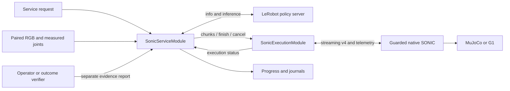

# SONIC service coordinator

`SonicServiceModule` turns the existing observation → LeRobot inference → SONIC
execution flow into a reusable DimOS service. It accepts a named policy, a task
instruction and a streaming duration, then supervises one request through
completion or cancellation. SONIC retains motor control.

This is the next layer above the
[validated execution module](/docs/platforms/humanoid/g1/sonic-execution-native-validation.md). The new
coordinator has passed local protocol and worker-process tests, followed by
[native MuJoCo/Pi0.5 validation](/docs/platforms/humanoid/g1/sonic-service-native-validation.md) through its
service RPCs. Hardware commissioning remains pending.



## Compose the stack

Source: `sonic_service_module.py` (`/dimos/robot/unitree/g1/sonic_service_module.py`).
The typed `SonicExecutionSpec` dependency is injected by `autoconnect()`.
Endpoints are configured explicitly; building the modules opens transports
but does not start a controller task.

This example defines the **simulation profile** used for native validation.
The observation producer and external native/policy processes must be supplied
by the deployment. The simulated hand mapping is not a hardware configuration.

```python skip
import os
from pathlib import Path

from dimos.core.coordination.blueprints import Blueprint, autoconnect
from dimos.robot.unitree.g1.sonic_execution_module import SonicExecutionModule
from dimos.robot.unitree.g1.sonic_service_module import SonicServiceModule
from dimos.robot.unitree.g1.sonic_session import SonicModelProfile


def service_stack(observation_source: Blueprint) -> Blueprint:
    journals = Path(os.environ["SONIC_JOURNAL_DIR"])
    profile = SonicModelProfile(
        name="pi05-wbt-sonic78-50hz-live-sim-observations",
        source_fps=50,
        right_hand_order="mujoco_swap",
        handback_policy="native_planner",
        first_chunk_timeout=2.0,
        max_duration=25.0,
        max_observation_age=0.85,
    )
    return autoconnect(
        observation_source,
        SonicExecutionModule.blueprint(
            reference_bind=os.environ["SONIC_REFERENCE_BIND"],
            feedback_endpoint=os.environ["SONIC_FEEDBACK_ENDPOINT"],
            journal_dir=journals / "execution",
            profile=profile,
        ),
        SonicServiceModule.blueprint(
            policies={"pi05": os.environ["SONIC_POLICY_ENDPOINT"]},
            execution_profile_name=profile.name,
            journal_dir=journals / "service",
        ),
    ).global_config(n_workers=2, viewer="none")
```

Every configured policy alias must match the declared execution profile:
sonic78 semantics, source FPS, hand order, normalization and native model.
The profile-name check detects configuration mismatches; it does not prove
checkpoint compatibility. Policy metadata checks only the supported history
and image layout. Instructions must match the selected policy's capabilities.

The observation source publishes `observation: Out[SonicObservation]`:

- One RGB `uint8[480,640,3]` image and 28 measured arm/hand joints in
  [`POLICY_JOINT_NAMES`](../../../../dimos/robot/unitree/g1/sonic_observation.py) order.
- A strictly increasing sequence and an original timestamp on the coordinator
  host's monotonic clock: paired capture time for `time_basis="acquisition"`,
  or the oldest of four original receipts for `time_basis="delivery"`.
  Cross-host clock mapping is not provided.
- New snapshots must be younger than 200 ms by default. Replayed, stale and
  future snapshots are rejected without replacing the last valid observation.

The coordinator consumes these snapshots; it does not open a RealSense camera
or derive joint/image alignment. The validated simulation capture can supply
them, as demonstrated in the native check. The reusable
[D435i observation adapter](/docs/platforms/humanoid/g1/sonic-observation-adapter.md) now provides diagnostics
and pairing; a hardware producer with body/hand acquisition timestamps remains
required for that acquisition contract. The selected
[delivery-freshness prototype](/docs/platforms/humanoid/g1/sonic-delivery-observations.md) supplies a separate
adapter and requires explicit matching service/execution timing profiles.

## Request and inspect a service

After building the composed stack, obtain the proxy with
`coordinator.get_instance(SonicServiceModule)`. These are RPC methods, with no
automatic LLM skill exposure:

| RPC | Result |
| --- | --- |
| `request_service(policy_name, instruction, duration_seconds)` | Reserves a service ID immediately; preflight and execution continue in the background. Rejects overlap, unknown policy, invalid duration and missing fresh observations. |
| `get_service_status()` | Lifecycle state, admission availability, observation age, latest service, progress and any latched fault. |
| `cancel_service(service_id)` | Records cancellation intent promptly; poll until `phase == "done"` for the result. |
| `report_outcome(service_id, success, evidence)` | Records one external outcome report after termination. Requires nonempty evidence and the current service ID. |
| `handle_observation(observation)` | RPC alternative to the typed input stream; applies the same validation. |

```python skip
service = coordinator.get_instance(SonicServiceModule)
request = service.request_service(
    policy_name="pi05",
    instruction=task_instruction,
    duration_seconds=8.0,
)
service_id = request["service_id"]
status = service.get_service_status()
# To interrupt this request:
# service.cancel_service(service_id)
```

`phase` progresses through `preparing`, `executing`, `recovering`, and `done`.
`progress` measures the requested streaming time, starting with the first
accepted prediction. It freezes when streaming stops. It is not grasp progress.
The requested duration reserves startup and finish time inside the execution
profile's total deadline; incompatible budgets fail before task admission.

`outcome="finished"` and `handback_confirmed=True` establish a completed
streaming interval and native planner handback. `task_success` remains `None`.
An operator or separate verifier can then report an object result with evidence.
This RPC stores a report; it does not inspect images or independently verify it.
A success report requires finished execution with confirmed handback. Failed
and cancelled requests can receive a failure report.

Status retains the current/latest request only. Report its outcome before
admitting another request; older IDs cannot cancel or alter a newer request.
JSONL journals retain each request, execution binding, accepted prediction
sequence/timestamp, cancellation, terminal status and reported outcome.

## Supervision and recovery

Inference runs in an owned worker thread while the coordinator continues
supervising execution. Only one inference is outstanding. The default 350 ms
replan cadence is measured between request starts, with no queue of missed
inference slots. Every result retains its original observation timestamp.
The execution module independently checks source age, action bounds and
native feedback; it also owns reference pacing and expiry.

In delivery mode, the coordinator checks input liveness during seeding, waiting
for inference and streaming, and requests recovery on expiry. The input-age
deadline and execution profile's prediction-age limit are separate, visible
budgets. Neither is a guaranteed physical stopping time. Journals preserve the
four original input receipts for each inference request.

Cancellation during an in-flight start waits for that start's returned task ID
and cancels the same task. Late inference results are discarded after streaming
stops. Policy errors trigger execution recovery. A lost execution RPC reply,
ownership change or unconfirmed handback latches a fault and blocks new requests.
The coordinator never retries an ambiguous start. Resolve controller ownership
and replace the faulted module before resuming; a restart does not resume work.

Injected execution RPCs use explicit per-method timeouts, default 500 ms.
Policy timeout defaults to 2.5 s; the independent execution expiry can stop a
request earlier. Stop requests cancellation, waits for bounded handback and
drains outstanding inference. Native receiver expiry remains necessary if a
process or filesystem stalls. This integration assumes exclusive ownership of
the execution module and its configured native reference route.

## Verification on 2026-10-12–13

**262 focused SONIC tests pass**, including **24 coordinator cases**. The new
tests cover timestamps and observation rejection, admission/profile budgets,
finish, overlap, task isolation, preflight and in-flight cancellation, frozen
camera, policy errors, lost RPC replies, missing handback, shutdown and outcome
reports. Two tests use actual DimOS worker RPCs: a composed blueprint with the
observation stream and a real local policy protocol endpoint, and an unavailable
execution endpoint to check the configured timeout.

The policy/native peers return scripted protocol data. These checks started no
native controller, physics simulation, GPU inference server or real robot.
Independent source review found no remaining material issues after its three
findings were fixed. Focused Ruff, production mypy and registry checks are
recorded in the [verification record](/docs/artifacts/g1_sonic_service_20261012/verification.json)
and test log (`../../../artifacts/g1_sonic_service_20261012/pytest.log`).
The complete repository suite was not run. The existing test-startup subprocess
`ResourceWarning` remains visible in the log.

The subsequent [native validation](/docs/platforms/humanoid/g1/sonic-service-native-validation.md) passed
finish, cancellation and camera expiry through the service RPCs with real
Pi0.5 inference and guarded native SONIC. Its guide records the replay,
independent evidence audit, recovery timings and physical-motion limitations.
The [acquisition adapter](/docs/platforms/humanoid/g1/sonic-observation-adapter.md) requires verified
body/hand acquisition timing. The subsequent
[delivery-freshness implementation](/docs/platforms/humanoid/g1/sonic-delivery-observations.md) passed 366
focused SONIC tests, including 31 coordinator cases, with acquisition timing
explicitly unknown. Real pairing and service commissioning remain pending.
Object-outcome verification remains a separate service capability.
