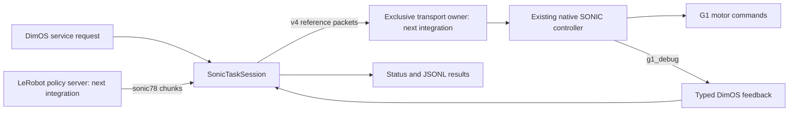
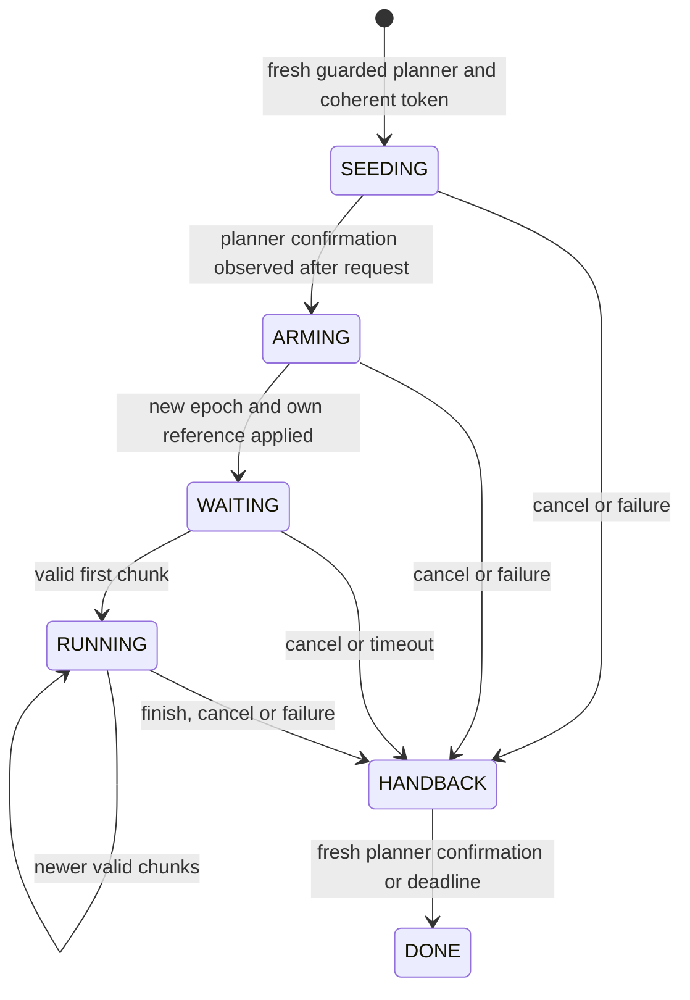

# DimOS SONIC task session: offline foundation

Implemented and checked on 2026-10-08. DimOS now has a transport-free
`SonicTaskSession` for the existing sonic78 → SONIC v4 route. It starts a
reference session, accepts policy chunks, exposes status, cancels or finishes
streaming, and checks native planner feedback before reporting handback.

This completes the offline session boundary in the
[LeRobot integration roadmap](/docs/platforms/humanoid/g1/lerobot-sonic-integration-reference.md#revised-next-steps).
The next step is to attach it to the isolated, guarded native SONIC/MuJoCo
environment. No real G1, native controller, GPU inference or camera was
operated in this session implementation step. The demonstration uses scripted
feedback and synthetic actions; its times are explicitly advanced test time.

## Where this fits



SONIC remains the motor-command owner. The new class is a one-shot Python
session, not a registered robot blueprint or an automatically exposed agent
skill. Its injected packet sink must belong to one external publisher. It
does not acquire a cross-process lock or establish exclusive ownership on the
network.

## Implemented lifecycle



- Startup requires the already-running controller to report a confirmed
  planner. The optional 64D `token_state` is decoded from the same packet as
  measured hands. Old passive feedback without this field remains supported;
  it cannot start a command session.
- Seeding uses the captured planner token and measured hand positions. It
  sends no implicit zero-hand target. Mode-only commands use `start=false`,
  `stop=false`; this class never powers or shuts down the controller.
- Streaming activation requires the next native guard epoch and an applied
  index from this session. Retained indices from an earlier epoch cannot
  activate it. Observed ownership violations remain latched even if another
  feedback sample arrives before the next tick.
- Output is capped at one reference every 20 ms. A late tick sends at most one
  frame; it never produces a catch-up burst. The default allowed tick gap is
  100 ms, below the prototype receiver's 200 ms lease.
- Chunks require the task ID, increasing sequence and observation time, finite
  `[N,78]` values, a valid remaining horizon and an explicitly selected 30 or
  50 Hz source rate. Sampling follows observation time, so late inference
  skips elapsed action time. Recent arrival alone does not refresh old data.
- Linear interpolation covers each source interval. The final sample remains
  valid for its last source period only: 40 samples at 50 Hz expire at 0.8 s.
  Observation-age limits can expire a chunk sooner. Late replacements cannot
  revive an already-expired session.
- Chunk transitions blend from the last sent action. A configurable token-step
  bound defaults to 0.05 per emitted packet; it is **not** a measured joint-speed
  limit. Hands are blended but have no commissioned physical limit filter yet.
- `cancel()` and `finish()` request native planner control directly and stop
  policy references. A fresh, newer, non-regressed guard confirmation must
  arrive within the handback deadline. Confirmation says which controller path
  ran; it does not prove settling, grasp retention or placement.

The explicit `handback_policy="native_planner"` acknowledges that the native
planner takes over body and hands. This foundation does not reproduce
LeRobot's entire finish/return blend or implement recovery while carrying an
object. That transition needs its own native simulation and grasp tests.

## Python interface

Source: sonic_session.py (`/dimos/robot/unitree/g1/sonic_session.py`).

| Operation | Caller responsibility / result |
| --- | --- |
| `SonicModelProfile(...)` | Pin model name, source FPS, native/simulated right-hand order and explicit handback policy. Only direct sonic78 is supported. |
| `SonicTaskSession(task_id, profile, send=..., journal=...)` | Supply one exclusive packet sink and an event journal. Calls must be serialized. |
| `start(feedback, now=...)` | Validate fresh decoded planner feedback; create one bounded session. Reusing the instance is rejected. |
| `observe(feedback, now=...)` | Accept increasing feedback indices and receipt times. Does not publish a pose. |
| `submit_chunk(task_id=..., sequence=..., observed_at=..., actions=..., now=...)` | Validate/copy the policy response; mismatched or stale responses are rejected. |
| `tick(now=...)` | Run at 50 Hz, including during handback. Applies deadlines and emits at most one pose. |
| `cancel(now=...)` / `finish(now=...)` | Request handback. `finish` means the caller ended streaming, not that the object task succeeded. |
| `status` | Immutable phase, outcome, reason, handback confirmation, last wire index and accepted chunk sequence. |

Use the same local monotonic clock for `now`, feedback receipt and
`observed_at`. Here `observed_at` is the chunk's first action time, associated
with the captured observation. Do not put a remote host's unsynchronized clock
or the policy response arrival time in that field. Received telemetry freshness
does not by itself establish freshness of the underlying DDS measurements.

The `native` hand profile uses dataset/native right-hand order. `mujoco_swap`
uses the explicit LeRobot `[0,1,2,5,6,3,4]` permutation. Startup measured hands
are converted into policy order and back when serialized, preserving the
original motor targets. Physical anatomical mapping still needs verification.

`JsonlSessionJournal(path)` creates a new file and flushes/fsyncs lifecycle,
chunk and fault records as they occur. Records include the profile, task ID,
source/receipt times, coherent feedback, wire/chunk counters, chunk hashes and
terminal result. It does not record every wire packet. Storage and packet
callbacks must be bounded; blocking callbacks can miss the next tick. A
journal failure stops further policy output and attempts planner handback,
then raises with recovery explicitly unconfirmed. Native expiry is essential
if the process or caller stops running.

## Verification and replayable evidence

Focused test log (`../../../artifacts/g1_sonic_session_20261008/pytest.log`):
**182 passed**, 73 feedback tests, 55 serialization tests and 54 session tests.
Production mypy passed for the two changed source files using
`--follow-imports=silent`. Ruff checks and formatting passed for the five
touched Python files. The test environment emits the same subprocess
`ResourceWarning` seen in the 123-test baseline; this is not a whole-repository
test-suite result.

[Final scripted results and source hashes](/docs/artifacts/g1_sonic_session_20261008/run02/result.json):

| Case | Session result | Planner confirmed |
| --- | --- | --- |
| Caller finishes streaming | `finished` | Yes |
| Caller cancels | `cancelled` | Yes |
| Policy chunk runs out | `failed` | Yes |
| First inference never arrives | `failed` | Yes |
| Feedback disappears | `failed` | No |
| Planner never acknowledges | `failed` | No |

Each case has a JSONL journal beside the result. Earlier `run01` was also
successful, before the final ownership-fault latch and demo lint correction;
`run02` is the final code evidence. Review found and corrected deadline
bypasses, epoch regression, wire-index exhaustion and overwritten ownership
evidence. Their regression tests passed after reproducing each failure.

Reproduce without any robot connection, using a new output directory:

```bash skip
cd /home/jihun/work/dimos_dev
.venv/bin/python docs/artifacts/g1_sonic_session_20261008/demo_session.py \
  --output /tmp/g1-sonic-session-demo
```

## Next: native MuJoCo boundary test

**2026-10-09 update:** The [native boundary test](/docs/platforms/humanoid/g1/sonic-native-session-validation.md)
completed one recorded episode and four fault cases using this session core.
Planner transitions, cancellation, consumer feedback loss and actual publisher
loss were observed; a recorded-pose video and measured-speed plot are available.
Contact/speed observations and loaded-hand recovery remain explicit limits.
The next integration step is the LeRobot policy-server connection in simulation.

1. Connect a sole publisher and the typed subscriber to the existing isolated
   SONIC receiver-guard build. Confirm the exact mode-only command behavior,
   epoch, frame-index and handback telemetry with this class.
2. Replay a recorded sonic78 episode with explicit 50 Hz policy timing and
   simulated hand order. Log measured arm/hand speeds and render the replay.
3. Inject cancellation, delayed inference, lost feedback and publisher loss.
   Assess planner transition and settling separately from session status.
4. Connect the LeRobot policy server and matched camera/state inputs after the
   transport/native tests pass. Then commission the exact guarded PC2 build
   and hand recovery behavior before a physical rollout.

The wire protocol still has no session nonce or acknowledged command
transaction. Local epoch/index checks are evidence checks, not an ownership
lock or protection against delayed messages from another publisher. The guard
patch is verified in isolated simulation; installation on PC2 remains a
separate commissioning step.
