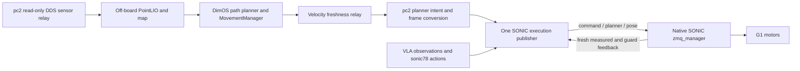

# G1 navigation through SONIC planner mode

Status: user conditionally approved on 2026-10-13; the two required amendments
are incorporated below. The staged implementation plan is prepared separately.
Production implementation and hardware motion have not started.

## Intended result

The user selected SONIC planner mode for movement direction, speed and facing,
with a later switch to pose mode for VLA manipulation. DimOS supplies mapping,
path planning, command admission and phase coordination. A single native SONIC
controller owns the robot motors throughout navigation and manipulation.

This session targets **pc2, 192.168.0.223**, independently of pc2_222. It must
preserve both workspaces' existing source changes, Python environments, installed
controllers and ongoing jobs. A separate task directory/image and private native
source copy are used for any implementation, build or deployment.

## Sources and evidence

Read the existing `/home/jihun/work/GR00T-WholeBodyControl` checkout as requested.
Its HEAD is `7c6d710b783a984ede504d24a65bc70e486b3b1d`; several teleop/VLA files
have local modifications. Findings describe this checkout and the separate
guarded runtime, rather than claiming they are identical to current upstream.

Primary source files:

- `gear_sonic/utils/teleop/zmq/zmq_planner_sender.py`: command/planner/pose serialization.
- `gear_sonic/utils/inference/planner_heading_frame.py`: world-to-reference conversion.
- `gear_sonic/utils/inference/manual_planner.py`: local direction/speed/facing example.
- `gear_sonic_deploy/src/g1/g1_deploy_onnx_ref/include/input_interface/zmq_manager.hpp`: mode selection and planner timeout.
- `gear_sonic_deploy/src/g1/g1_deploy_onnx_ref/include/output_interface/output_interface.hpp`: measured IMU heading and reference correction; its measured translation is a fixed placeholder.
- `gear_sonic_deploy/src/g1/g1_deploy_onnx_ref/src/g1_deploy_onnx_ref.cpp`: planner inference and heading correction.
- `docs/source/references/planner_onnx.md` and `docs/source/tutorials/vla_inference.md`.

Official references: [repository](https://github.com/NVlabs/GR00T-WholeBodyControl),
[planner model](https://nvlabs.github.io/GR00T-WholeBodyControl/references/planner_onnx.html),
[manager workflow](https://nvlabs.github.io/GR00T-WholeBodyControl/tutorials/vr_wholebody_teleop.html),
[token streaming](https://nvlabs.github.io/GR00T-WholeBodyControl/tutorials/zmq.html).

The offline [protocol check](/docs/artifacts/g1_navigation_sonic_20261013/protocol-check.json)
passed 11 cases using AST-extracted existing functions, without imports that
start controllers, sockets, robot commands or native inference. It checked the
packet layout, forward/strafe/IDLE examples, mode-only command parity, sonic78
pose parity, frame conversion, initialization IDLE and missing-frame rejection.
It establishes serialization and math compatibility, not robot execution.

## Actual protocol

The manager subscribes to `command`, `planner` and `pose` on one publisher endpoint.
Messages are a topic prefix, **1,280-byte padded JSON header**, and little-endian
binary payload. The minimal planner packet is **1,323 bytes**:

| Field | Wire type | Meaning |
| --- | --- | --- |
| `mode` | i32[1] | 0 = IDLE, 1 = SLOW_WALK; other styles excluded from initial navigation |
| `movement` | f32[3] | Direction, separate from speed; horizontal vector |
| `facing` | f32[3] | Independent horizontal heading direction |
| `speed` | f32[1] | Positive target speed in m/s; achieved speed must be measured |
| `height` | f32[1] | -1 disables explicit height control |

This is the legacy minimal packet size; guarded extensions add payload fields.
The local sender's pose-packing docstrings still say 1,024 bytes, although the
actual `HEADER_SIZE` is 1,280. The codec follows the constant and receiver.

Use IDLE and zero movement for a navigation stop. The model documentation says
nonpositive speed selects the mode's default speed; the C++ struct comment calls
zero stationary. IDLE avoids relying on that conflicting description. A mode-only
command uses `start=false, stop=false`, with `planner=true` for navigation or
`planner=false` for streamed references. `stop=true` shuts down/damps control and
is not the ordinary navigation cancel operation.

The existing DimOS pose encoder matches the local v4 format: 64 latent token
values, seven left-hand motor targets and seven right-hand targets, with int64
frame index. Selecting pose mode alone does not produce manipulation actions;
the VLA model and observation/action contracts must match that sonic78 route.

## Design

Create a SONIC-specific sensor/navigation composition and extend the current
`SonicExecutionModule` publisher under mutually exclusive navigation/pose phases.
A small pure planner codec and conversion component perform the mapping. The
service coordinator requests handoff through the execution owner.

### Blueprint and motor ownership

Do not compose `unitree_g1_nav_simple` or `_unitree_g1_onboard` into this stack.
Their onboard primitive contains `FastLio2` and `G1HighLevelDdsSdk`; the latter
selects the stock motion mode at startup and consumes `cmd_vel` through
`LocoClient.Move`. Autoconnect would wire MovementManager's output to both that
module and a new SONIC `cmd_vel` input.

The new SONIC sensor primitive contains read-only DDS MID360S cloud/IMU and G1
state/TF sources. The navigation composition uses **PointLio**, with the existing
validated DDS field conversion, followed by `RayTracingVoxelMap`, `CostMapper`,
`ReplanningAStarPlanner` and `MovementManager`. It does not use direct `FastLio2`.
Use `initial_safe_radius_meters=0`; preserve observed occupied and unknown cells.

There are **two independent blueprints**, `unitree_g1_sonic_navigation_peer` on
the workstation and `unitree_g1_sonic_navigation_pc2` on pc2. DimOS does not
partition a blueprint across hosts. Each blueprint receives its own resolved
graph validation, including stream remappings, before workers start.

Their command/control connection is a new named component, **SonicNavigationLink**:
`SonicNavigationPeerModule` serves requests on the workstation and
`SonicNavigationRelayModule` polls/forwards them on pc2. This is custom private
unicast request/reply transport code, not an existing DimOS distributed-blueprint
feature. Sensor DDS forwarding is a separate read-only relay. Validate both
blueprints against these ownership rules:

- The actuation-side `navigation_input: In[NavigationInput]` consumer is exactly
  `SonicExecutionModule`; its Twist, source sequence and deadlines arrive atomically.
- The off-board velocity relay is the only permitted nonactuating consumer of
  MovementManager's off-board `cmd_vel`; it cannot publish stock/low-level commands.
- The relay is the only pc2 NavigationInput producer and connects only to the
  execution owner. Nothing on pc2 produces or consumes cmd_vel. Fail build on
  another consumer/producer or an alternate command source.
- Reject `G1HighLevelDdsSdk`, WebRTC locomotion modules, `G1WholeBodyConnection`,
  alternate policy motor writers and any duplicate SONIC publisher. Modules must
  belong to the explicit sensor/navigation/relay/execution allowlist; unknown
  modules fail validation rather than being presumed read-only.
- Exactly one publisher binds the configured native command endpoint, and exactly
  one externally commissioned native process owns motor control. Graph validation
  cannot detect unrelated processes: inspect real runtime ownership before launch.

Require all `{b"command", b"planner", b"pose"}` native subscriptions both in
`subscriptions_ready` and in active-navigation/active-pose subscription-loss checks.
A lost required subscription faults admission, stops new movement and prevents
pose activation; successful socket sends are not controller acknowledgment.

Alternative keyboard injection is useful manually, but has input momentum and
cannot provide the selected typed inputs and handoff evidence. A second motor
controller would require another ownership transfer and is unsuitable for this
user-selected continuous SONIC workflow.

### Coordinate conversion

The planner model uses X-forward, Y-left, Z-up in its own reference world. That
world is not automatically the DimOS map world or the measured robot body frame.
For a body-frame forward velocity, rotate its direction by measured body yaw,
then apply the inverse yaw from `reference_heading_quat`. Normalize the resulting
direction and set speed to `abs(vx)`. Negative vx means backward direction, not a
negative speed. Convert the independently held world-facing vector through the
same inverse reference rotation.

Initial navigation supports forward/backward speed and yaw rate. The current A*
follower produces forward velocity and yaw rate, not strafe. Keep sideways
movement in codec tests only; reject unsupported lateral/vertical/roll/pitch
inputs at navigation admission rather than silently discarding them.

Use `nerf_speed=0.2 / 0.55` on the off-board follower so its nominal speed is
0.2 m/s before conversion. Keep the linear floor at 0.2 m/s; make the current
class-level `_min_angular_velocity` an instance setting, exposed through
`ReplanningAStarPlannerConfig.min_angular_velocity` with default 0.2 rad/s. Pass
it through GlobalPlanner and LocalPlanner to PController; set it to **0.0** only
in this composition. Retain defaults for existing compositions. With the
existing proportional gain 0.5, yaw errors of +0.01/-0.01 rad then yield
+0.005/-0.005 rad/s, rather than bang-bang +0.2/-0.2. The resulting facing
lead is +0.0025/-0.0025 rad, below the 0.02 update threshold. Test a translating
trace whose error crosses zero to verify held facing and bounded replans, as
well as the actual emitted Twist envelope. Do not silently clip an A* request from 0.55 to 0.2. Over-limit relay or
teleop requests produce IDLE and a rejected-input status; valid input can recover
unless a separate fault latch is set. The native guard independently enforces
the configured ceiling. Native MuJoCo selection is separate from the follower's
`GlobalConfig.simulation`; keep the latter disabled (`""` in this HEAD) in this composition, avoiding
its 0.8 rad/s minimum turn override.

The native simulation exposed an additional drift path: tiny nonzero turn
commands can repeatedly re-anchor facing to measured yaw after a real turn,
even with the angular floor disabled. Apply a 0.01 rad/s turn deadband in the
intent tracker before converting facing. Commands inside that band act as
zero yaw rate, holding world facing during translation and frozen stop facing
in IDLE. This is below the commissioned 0.1–0.2 rad/s turn inputs and corresponds
to a 0.02 rad yaw error at the follower's gain, below its 0.35 rad orientation
tolerance. Test measured heading drift as well as alternating sensor noise.

Initial conversion parameters, all explicit configuration values:

| Parameter | Initial value | Effect |
| --- | --- | --- |
| `min_walk_speed` | 0.10 m/s | `abs(vx) < threshold` becomes IDLE with zero movement; no upward speed rounding |
| `max_walk_speed` | 0.20 m/s | Admission/native cap; lower supported speeds need measured validation |
| `max_yaw_rate` | 0.20 rad/s | Matches the configured current follower envelope |
| `turn_deadband` | 0.01 rad/s | Treat `abs(wz) <= deadband` as zero before facing conversion |
| `facing_lookahead` T | 0.50 s | Converts requested turn rate to a finite facing target |
| `max_facing_offset` theta_max | 0.10 rad | Bounds each target relative to measured yaw |
| direction/facing update threshold | 0.02 rad | Wrapped angular difference from last emitted target |
| speed update threshold | 0.01 m/s | Difference from last emitted target; mode/zero transitions bypass it |

For a fresh command with `abs(wz) > turn_deadband`, compute
`target_yaw = measured_yaw + clamp(wz * T, -theta_max, +theta_max)`.
This also applies during translation. There is no accumulated turn integrator.
For `abs(vx) < min_walk_speed` and nonzero wz, send **IDLE**, zero movement and
zero speed with that facing target: this is the required turn-in-place path.
For translation with zero wz, hold the last world-facing target; seed it from
measured yaw at navigation entry. A below-minimum linear command with zero wz
is treated as a stop. For a stop, cancellation or expiry, snapshot facing once
at the yaw measured on entry to the stopped state; repeated zero/tiny commands
and heartbeats retain that target rather than tracking later IMU noise. If
feedback is missing, retain the last valid stopped target and fault.

Compute candidate values on fresh source commands at the follower's 10 Hz rate,
not on the 50 Hz heartbeat. Compare converted facing/direction angles and speed
against the last emitted state using the thresholds above. Preserve the exact
previous float32 motion fields below threshold; do not renormalize/repack them
from noisy telemetry each heartbeat. Heartbeats change only sequence/deadline.
Mode transitions and an explicit stop bypass thresholds. Re-anchor into a new
valid reference frame on a reported heading reset/reinitialization; never reuse
old frame-dependent values after a transition. This prevents exact-float-change
replanning on every planner tick while still following actual steering changes.

Approved test clarification (2026-10-13): keep the ≤1 native motion-state-replan
bound, including walking entry, for a labelled constant-heading noise fixture.
The separate live translating proof retains measured-yaw body-frame conversion
and reports all direction replans due to real body-heading changes. Each emitted
change must have an admitted fresh source threshold crossing or mode/sign/frame
transition; each native state replan must match an applied acknowledged changed
intent. Heartbeats cannot cause state replans. Measure five seconds from applied
walking while counting from its request, preserving the initial transition.
This clarification does not relax measured stopping or commissioning gates.

Missing, invalid or inactive reference telemetry blocks walking and requests
IDLE. Direct map-frame inputs are excluded from initial admission. Navigation
commissioning requires the accurate sensor-to-base extrinsic and base-frame
odometry/TF chain. The follower uses PointLio yaw and emits body-frame commands;
no map-to-IMU-world heading alignment is required.

SONIC feedback's `base_trans_measured` is a fixed visualization position. PointLIO
and the verified G1 TF chain must supply navigation translation; SONIC IMU heading
and measured joints provide controller feedback.

### Feedback interfaces

Extend `SonicFeedback` and its decoder with optional typed fields
`base_quat_measured` (four values, wxyz), `reference_heading_quat` (four values,
wxyz), and `planner_reference_active` (boolean, decoded from its [0]/[1] wire
array). Require finite, nonzero-norm quaternions and exact array sizes; normalize
valid quaternions for yaw extraction. All three must come from the same fresh
feedback packet before navigation can be admitted. Missing legacy fields remain
compatible with passive feedback, but do not establish navigation readiness.
A malformed present field rejects the packet and does not refresh feedback age.

The local guarded runtime publishes these fields, while pc2's inspected source
does not. Commission the matching private native build before using them. Add
typed planner-guard status: mode, accepted/applied sequence, lease state, fault
latch and IDLE/rearm acknowledgment. Keep it distinct from the pose guard's
reference-index/epoch state; mode selection alone is not application confirmation.

### Phase ownership and handoff

The existing `SonicExecutionModule` already binds the sole command/pose publisher
endpoint and admits one pose task. Extend that same owner, rather than bind a
second navigation publisher. Navigation and VLA pose streaming cannot both be
admitted. Module startup remains passive and does not start/stop native control.

Before manipulation: cancel the navigation goal, reject new navigation requests,
publish IDLE, observe fresh planner state and measured settling, then run the
existing task session's coherent-token seeding and acknowledged pose activation.
Do not stream planner heartbeats during pose mode. Keep incoming navigation goals
rejected until manipulation finishes or cancels and a fresh planner handback is
confirmed. Clear all old velocity targets on each transition. Resume IDLE; require
a new navigation request. Handback confirmation alone does not establish object
retention, placement or physical settling.

The cancel path is concrete: the execution owner gates the atomic
`NavigationInput` first, then requests cancellation from the off-board peer.
That peer uses a typed locally injected navigation Spec to invoke the existing
public `ReplanningAStarPlanner.cancel_goal()` RPC; it also returns fresh
`get_state()` evidence. This calls `GlobalPlanner.cancel_goal()` and
`LocalPlanner.stop_planning()`, which publishes a zero Twist. Do not call private
`MovementManager._cancel_goal()` or rely on a NaN goal. Cancellation RPC/peer
failure leaves the velocity gate closed and records unresolved cancellation;
it cannot authorize pose admission or a navigation resume. The gate covers
MovementManager's teleop output as well as A* output.

Cancellation returns promptly after fresh planner IDLE evidence. Separately,
the peer derives measured planar speed and yaw rate from advancing PointLIO
pose samples. Its correlated status proves both remain within 0.03 m/s and
0.03 rad/s for at least 0.5 s; default zero odometry Twist and commanded zero
velocity cannot prove settling. The relay converts proof age to a pc2-local
deadline capped at 350 ms. The execution owner requires applied native IDLE,
matching cancellation, and fresh measured settling before pose admission,
and keeps polling that proof until pose begins. Its single outstanding peer
control call runs outside the heartbeat loop with a 500 ms transport timeout.

An **explicit navigation request** is the execution owner's `begin_navigation()`
RPC after fresh feedback and peer/subscription readiness. It creates a new local
request ID, clears old targets and requires a newer accepted source sequence.
Goal navigation goes through a coordinator operation that invokes that RPC and
then the peer's public `set_goal()`; teleop must explicitly begin its navigation
session before sending commands. Raw Twist arrivals, heartbeats, old goals and
pose handback never invoke rearm implicitly. Reject concurrent begin requests
during manipulation, cancellation or handback. `end_navigation()` closes the
gate, publishes stopped IDLE and cancels the remote goal.

For a latched fault, begin requests send an explicit deadline-bounded native
rearm command with `planner=true` and no start/stop flag. Rearm commands and
guarded planner packets share one strictly increasing sequence space. Native
records the rearm sequence as a barrier, clears pending motion and accepts the
first fresh **exact-zero IDLE** packet above that barrier; its IDLE acknowledgment
is required before movement is admitted. Retain the sequence high-water mark
across begin/end and pose cycles. Native packets contain sequence/deadline,
**no request ID**; request IDs remain local/peer RPC correlation only. Duplicate,
regressed or expired rearm commands cannot clear a latch, and old buffered
packets below the barrier cannot authorize the new session.

A publisher restart requires an explicit fresh commissioning/session handshake
and native feedback of the retained high-water mark. Drain obsolete queues,
wait at least one 250 ms lease interval, then start above that mark; never reset
it implicitly. A native restart starts with admission closed and also requires
explicit commissioning. A sequence reset alone cannot revive an old target.

The native planner lease is armed only after that explicit begin/IDLE handshake.
It remains armed during recoverable source-age pauses, maintained by IDLE packets.
End-navigation, pose activation and confirmed handback leave it disarmed in
stopped `awaiting_navigation_request`; waiting without a goal does not itself
cause a planner-lease fault. If expiry already latched a navigation fault, it
cannot be cleared just by an end request or an unsolicited IDLE packet.

Loaded-object handback is a later manipulation commissioning requirement. This
navigation work preserves the existing VLA contract and leaves grasp strategy
with the other session.

### Command freshness and native guard

Current unguarded SONIC falls back to IDLE after about one second without planner
messages, but applies a pending valid message before checking age. It provides no
universal deadline or acknowledged per-command transaction.

The separate `build/sonic-grasp-runtime/source` pilot has a 200 ms pose lease and
typed feedback guard, but `OnPlannerReceived()` immediately returns whenever that
guard is enabled: **all planner messages are deliberately discarded**. Disabling
the pose guard to gain locomotion would invalidate the existing handoff assurance.

Extend an isolated native copy with opt-in guarded planner admission, preserving
stationary-pilot defaults. Initial modes are restricted to IDLE/SLOW_WALK; planner
packets require exact shapes, finite values, horizontal movement/facing, positive
walking speed and a configured cap (initial commissioning cap 0.2 m/s). Ordinary
navigation packets omit arm, hand, VR and height overrides.

Run the publisher on the same pc2 host as native SONIC so **deadline** values use
a shared monotonic clock. Guarded planner payloads add a strictly increasing
sequence and absolute monotonic deadline. Rearm commands use the same sequence
space and deadline; drop both the request-ID and issue-timestamp native fields. Native caps the usable deadline at
`min(packet_deadline, now + 250 ms)` and checks it again **before installing** a
pending packet. Reject expired and duplicate/regressed packets, and packets outside the admitted
phase/rearm sequence barrier.
Legacy minimal packets remain offline-compatible and cannot authorize guarded
locomotion. Duplicate packets and rejected input do not renew the native lease.

Distinguish **motion validity** from **publisher liveness**. When an installed
motion deadline expires, native freezes measured stopped facing and forces
nonlatched IDLE; a pending expired motion is rejected before installation. The
independent 250 ms publisher watchdog is measured from the last accepted fresh
heartbeat's receipt, not from that heartbeat's motion deadline. Only loss of
those accepted heartbeats latches publisher loss. A fresh IDLE heartbeat has its
own `now + 250 ms` deadline and keeps liveness alive while original source motion
is expired. Thus expiry between 20 ms heartbeat ticks cannot turn an ordinary
source pause into a publisher-loss fault. Neither motion expiry nor an IDLE packet
clears a fault latch that was already set.

| Condition | Immediate behavior | Resume behavior |
| --- | --- | --- |
| Original source velocity age reaches 350 ms | Publish IDLE with stopped facing; keep the goal/session active | A newer valid source command resumes automatically; no latch/rearm |
| Original source velocity remains expired for 2 s | End navigation and cancel the goal, report input outage | A new explicit begin/goal request is required because the session ended |
| Native motion deadline expires while heartbeats are alive | Native forces nonlatched stopped IDLE | A newer valid source command resumes; no implicit renewal of the expired motion |
| Native publisher-liveness lease expires (250 ms since accepted fresh receipt) | Native forces IDLE and latches planner admission off | Explicit begin/rearm with a higher sequence barrier and IDLE acknowledgment |
| Controller feedback age reaches 200 ms or required subscription disappears | Close gate, request IDLE when possible, latch admission and cancel goal | Explicit begin/rearm after fresh readiness |
| Pose mode is active | Reject planner packets; planner lease timer is suspended | Confirmed handback initializes stopped planner IDLE and waits for explicit begin |

The 350 ms source age budget tolerates multiple missed 100 ms follower updates;
it is an explicit limit to test under load, not a claim about Orin scheduling.
The 50 Hz publisher keeps a fresh **IDLE** native lease alive during a temporary
source pause, and cannot refresh the expired source command by replaying its
nonzero motion fields. Native lease expiry remains independent of source expiry.
If the publisher itself stops, native expiry is the final fallback.

During pose activation, clear pending planner packets and stored nonzero targets,
suspend the planner timer/latch, and keep the existing 200 ms pose reference lease
and epoch checks running. On a fresh confirmed planner handback, reset planner
expiry accounting, install stopped IDLE, close movement admission and report
`awaiting_navigation_request`. Old planner sequences remain rejected.
Handback IDLE maintenance is allowed while waiting for begin; delayed navigation
packets cannot revive the prior session. If pose activation fails, the same
confirmed-IDLE recovery path is required. A newly confirmed handback may clear
the obsolete planner lease-expired indication, but not an unresolved feedback or
ownership fault. Explicit begin is still required after those faults recover.

Use bounded nonblocking queues and monitor subscriptions. Planner/mode acceptance
comes from native telemetry, rather than XPUB send success. During pose mode,
planner packets are rejected; pose reference lease and epoch checks stay enabled.
This trusted sole-publisher setup is not network authentication or a protection
against an arbitrary hostile publisher.

### Host placement and off-board command freshness

Initial placement uses the two independent blueprints and new
SonicNavigationLink components described above:

| pc2 / Orin | Workstation |
| --- | --- |
| Commissioned private native SONIC TensorRT controller | PointLio, ray map, costmap, A* and MovementManager |
| Thin read-only DDS sensor/TF relay | Navigation peer serving velocity and cancel/status requests |
| SONIC execution publisher, feedback receiver and input gate | Later policy server/inference, already isolated by the other session |

Start the five-module off-board navigation pipeline with `n_workers=5`, without
an LLM agent or heavyweight viewer in the commissioned control composition.
PointLio assets must match the workstation architecture. Do not move the stock
10–12-worker onboard blueprint onto Orin next to SONIC. Measure sensor relay and
publisher load with SONIC running before claiming coexistence; native control
lateness, DDS state freshness, planner timing and command age are acceptance
metrics. Persistent loop/state lateness blocks hardware commissioning.

Off-board `cmd_vel` transport is outside the publisher/native shared-clock
guarantee. Bare arrival time or relaying cached Twist at 50 Hz cannot establish
original source freshness. The thin navigation peer therefore retains each
original MovementManager sequence and arrival time on its own monotonic clock.
pc2 polls at 10 Hz with a per-request correlation ID, local request-start time,
and a bounded outstanding request. Replies contain that ID, the latest original
velocity sequence, original age measured immediately before reply, and current
navigation/cancel status. Never assign a new source sequence or timestamp to a
cached value. Drop mismatched/late replies and repeated source sequences for
motion refresh.

Let `a` be reported original age, `t0` the pc2 request-start time and `t1` its
reply receipt time. Conservatively bound source age at receipt by `a + (t1-t0)`;
set its local source deadline to `t0 + 350 ms - a`. Require nonnegative finite
age, round-trip time <=100 ms and an unexpired deadline. This includes the
network hop without assuming synchronized host clocks. Each moving native
heartbeat's deadline is no later than both that original-source deadline and
`now + 250 ms`. Expired upstream data yields IDLE heartbeats instead. Losing the
peer briefly follows nonlatched source expiry; an unresolved cancellation or
two-second outage terminates the session.

The peer and execution module communicate over explicitly configured private
unicast endpoints; no global multicast/firewall/daemon setting is changed.
Control/cancellation requests preempt velocity polling and have their own bounded
request slot, so a blocked poll cannot queue a stop behind it. pc2 closes its
local command gate before waiting for any remote operation. Planner cancellation
and reported state are correlated to the current request ID; an earlier cancel
acknowledgment cannot admit a later pose transition. A transport-only reply is
not a cancellation acknowledgment: the peer replies only after the injected
planner RPC has completed and fresh planner state has been queried.
Sensor packets preserve source sensor timing. Source-age claims here are for
navigation command admission, not proof of LiDAR hardware acquisition age.

The local relay supplies one atomic `NavigationInput` carrying the Twist,
original sequence and conservative deadlines. Execution consumes only this
input, with no separate cmd_vel/context pairing. Callbacks enqueue samples for
the serialized owner loop. Stale/duplicate samples cannot extend movement
deadlines. This metadata is confined to the new link/relay and does not alter
shared PointLio or mapping messages.

### Navigation-input readiness at runtime

Fresh Twist production alone is insufficient. The existing A* loop can keep
producing commands from cached `_current_odom` and costmap after localization or
sensor processing stalls. The navigation peer must supervise the inputs actually
used by the follower and include their readiness/progress in each reply.

Initial autonomous freshness budgets are 350 ms for advancing LiDAR/PointLio
cloud and localization/odom, 200 ms for IMU and dynamic base TF, and 1 s for
obstacle map/costmap processing. These are configuration limits to validate
against the real processing rates; static calibrated TF edges do not expire.
Amendment (2026-10-14, user-approved after the two-host simulation): the
monitored `odom→base_link` edge is composed once per PointLio scan, so it uses
the 350 ms LIO/odom budget. The 200 ms dynamic waist edge is enforced in the
sensor receiver before composition; a stale or duplicate waist edge produces no
base odometry. A 200 ms budget on the ~10 Hz composed edge expired between
10 Hz relay polls.
The peer tracks original advancing source sequence/stamp and original arrival
time for each required input. Repeated/stale source stamps and republished cached
outputs do not refresh that timer. Readiness requires valid finite base-frame
odometry, the commissioned sensor-to-base frame chain, advancing
sensor/localization progress, and a costmap derived from current input.

Reuse existing source stamps first: the validated DDS adapter preserves the
sensor header; PointLio publishes odometry/TF/cloud only on processed LIO
progress with `o.ts`; the ray map stamps its outputs with the consumed cloud
stamp; nonempty `height_cost_occupancy` propagates `cloud.ts`. The current empty
cloud branch lacks that explicit stamp; reject empty/invalid maps for readiness.
In this composition disable merged-map input and use only the monitored ray
map. The peer watches raw cloud/IMU, LIO cloud/odom, dynamic base TF and map/costmap
inputs and updates local monotonic progress time only when their original stamp
advances. Correlate derived stamps with the latest upstream stamp to detect
processing backlog; never subtract a sensor clock from an unrelated host clock.
A stamp rollback/reset makes the current peer unready; a fresh peer
commissioning handshake must establish a progressing, coherent chain before a
new explicit navigation session can be admitted. Stamps alone do not prove acquisition age; replay
and queue-delay tests must verify the pinned PointLio dependency
`3c1dcf8b9dfe6402aaf141e116f4caef6c5c8088` and relay progress.

No new metadata is threaded through shared PointLio/map/CostMapper modules. Add
metadata only at a demonstrated stage that republishes cached data with fresh
stamps; the first implementation must identify that stage with a failing test.
The new link reply carries the peer-computed input ages/readiness, rather than
changing shared message types.

The peer's original input ages are bounded on pc2 with the same correlated
request RTT rule as velocity age. Moving native deadlines cannot extend beyond
any required input's conservative deadline. Native expiry of such a motion still
forces nonlatched IDLE immediately; on detecting the readiness loss, the execution
owner closes navigation admission, ends the navigation session and cancels the
goal. An unchanged/freshly emitted Twist cannot restore it. Recovery requires
healthy input progression and an explicit new begin/goal request. The peer also
rejects goal admission while these prerequisites are unready.

Teleop passes through the same merged velocity gate and fault/phase logic. Initial
supervised teleop commissioning retains these sensor-readiness checks; a separate
mapless teleop mode is outside this design. Fresh input metadata does not by itself
establish near-field clearance or pose ground truth, which remain commissioning
requirements.

## Deployment findings on pc2

Read-only inspection on 2026-10-13 found no SONIC process, no task container and no
reference/feedback TCP listener. The repository is at
`a9d20b2ac0949244d94461a1a3263f38c5027c4a`, with local source changes. Its installed
binary SHA256 is `bc0b17c45d06e458b847c217ec62c9e1bbb8d7db66f6688750beceb5c773a3b5`.
SONIC v1.1 decoder/encoder/config/TensorRT assets and the V2 planner ONNX exist.
The inspected pc2 source has neither reference-frame telemetry nor the reference
guard. Source inspection cannot establish which local modifications its existing
binary contains. Do not overwrite that binary or rebuild in its checkout.

Build and test privately, then package a distinct ARM64 controller and explicitly
matched assets under the navigation task directory. Reuse existing compatible
system capabilities and container isolation; do not install into any existing
Python environment or alter firewall/daemon settings. Record source, binary and
model hashes before commissioning. `build/sonic-grasp-runtime/source` is not an
independent git checkout: record a SHA256 manifest for the native source files,
plus the controller binary, build configuration and model assets. A parent
repository commit cannot identify this private runtime's source changes.
A read-only [native-source baseline](/docs/artifacts/g1_navigation_sonic_20261013/native-source-provenance.json)
now records 51 C++/CMake files. It identifies the inspected baseline, not a new
build or an attestation of the installed binary's compiled source.

## Acceptance checks and order

**Stage A: on-host controller path, no off-board link required.**

1. Offline codec parity and shape/nonfinite rejection; strafe remains codec-only.
   Test new feedback fields for legacy absence, malformed content and coherence.
   Verify the configurable angular minimum defaults to 0.2 and is 0 in this
   composition; test small sign-changing yaw error, the 0.2 m/s/0.2 rad/s envelope
   and native simulation without the follower's 0.8 override.
2. Use an on-host scripted Twist source and readiness fixture to exercise the
   existing execution owner: frame reset, thresholded emitted fields, identical
   heartbeat motion fields under IMU noise, frozen stop facing, pure-turn IDLE,
   tiny-speed IDLE, all three subscriptions and explicit begin/end. Production
   readiness cannot be bypassed by the test fixture.
3. Native guard tests: planner applies with guard enabled; expired pending,
   stale sequence and pre-rearm packets are rejected before installation;
   duplicate sequence cannot renew liveness. Verify nonlatched motion expiry
   between healthy heartbeats, 350 ms recoverable source pause, two-second outage,
   250 ms publisher loss and 200 ms feedback loss. Delayed rearm cannot clear a
   latch. Preserve existing pose/reference tests.
4. Isolated MuJoCo with on-host Twist: stable IDLE, forward/backward, turns,
   explicit stop/cancel and measured settling, then planner → seeded VLA pose →
   planner IDLE. Pose lasting >250 ms must suspend the planner lease; pose loss
   still expires at 200 ms. Handback never resumes an old target. Measure native
   replans during noisy heading and a follower trace crossing zero yaw error.

**Stage B: new two-host link and navigation composition.**

5. Test SonicNavigationLink with stalled replies, wrong correlation, cached data,
   source rollback and unrelated host clocks. Moving deadlines must remain bounded
   by original source/input ages. Cancellation must reach the public planner RPC,
   and close admission before waiting even when the reply is lost. Freeze raw
   LiDAR/IMU, odometry and map/costmap separately while A* emits fresh Twist;
   readiness loss closes admission/cancels the goal. Cached republishes cannot
   hide the freeze. Verify source-stamp propagation with pinned/replayed data.
6. Validate **each** host's blueprint: reject stock SDK/FastLio, duplicate motor
   writers, alternate cmd_vel consumers/sources and missing required subscriptions.
   Validate PointLio → map → costmap → A* → MovementManager plus peer on the
   workstation, and read-only relay/execution on pc2. Simulate the complete link,
   phase handoff and network/process failures before deployment.

**Stage C: isolated pc2 commissioning.**

7. Package the private ARM64 runtime with matching models and hashes. Check
   coexistence/load, freshness and environment fingerprints. Obtain fresh
   standing/clear-area/operator-stop/sole-controller readiness. Demonstrate the
   stop path under native SONIC; stock remote walking alone is insufficient.
8. Supervised short walking/turning tests with measured displacement, explicit
   IDLE, stationary confirmation and cancellation evidence. Physical goal
   navigation follows only after accurate MID360S/PointLio sensor-to-base
   extrinsics, conservative footprint coverage and map clearance are established.
   Preserve unknown/occupied cells; never clear the 1.2 m startup disk to make a
   path appear traversable. Expand only from measured results.

The earlier DDS mapping and four failed stock-SDK motion pulses remain documented
in `docs/platforms/humanoid/g1/navigation-verification-2026-10-09.md`
in the original workspace; Task 9 imports and updates that report here.
SONIC resolves the selected locomotion interface; it does not itself resolve
LiDAR extrinsics, near-field coverage or autonomous clearance.

## Review fixes incorporated

| Review item | Resolution in this revision |
| --- | --- |
| 1. Second controller and FastLio mismatch | Dedicated SONIC sensor composition, PointLio selected, build graph/allowlist and command-consumer checks |
| 2. Noisy every-packet replans | Held world-facing target, thresholded converted motion state, unchanged heartbeat motion fields and frozen stop yaw |
| 3. 200 ms host expiry and ambiguous latch | 350 ms nonlatched source pause, separate fault latches, explicit begin/end and rearm semantics |
| 4. Pure turns, creeping speed, follower/cap mismatch | IDLE turns with finite lookahead formula, 0.10 m/s minimum, configured nerf_speed and explicit input rejection |
| 5. Missing feedback and subscription interfaces | Three coherent typed feedback fields; command/planner/pose required for readiness and loss checks |
| 6. Planner lease during pose | Suspend planner timer during pose; reset to confirmed IDLE and explicit begin on handback |
| 7. Host placement and network freshness | Heavy navigation off-board, thin pc2 publisher/relay; source-age plus correlated request RTT bounds network age |
| 8. Goal cancellation and teleop | Public planner cancel RPC through typed peer; merged cmd_vel gate covers teleop and A* |
| Simplifications | Native sequence/deadline only; sideways codec tests; source SHA256 manifest; reuse advancing source stamps |
| Final review amendments | Configurable angular minimum, set to 0 here; two independently validated blueprints and named new SonicNavigationLink |
| Staging | On-host codec/feedback/guard/MuJoCo before building the off-board peer |
| Independent review follow-up | Separate motion deadline/publisher watchdog; runtime navigation-input readiness rejects fresh commands built from stale state |

The preceding revision received an independent read-only specification review.
The user then conditionally approved it with the two final amendments above;
this revision incorporates them and the optional simplifications. Source claims
were checked against the cited local source; proposed acceptance tests remain
implementation work. This amendment does not claim a new independent review.

## Review boundary

This document specifies the user-selected shared-controller architecture and its
concrete missing interfaces. No production files belonging to the other session
have been edited. The conditional design approval permits preparation of the
[staged implementation plan](/docs/superpowers/plans/2026-10-13-g1-sonic-navigation.md); review
that concrete plan before implementation. Hardware launch remains a separate commissioning step
after software and simulation evidence.
